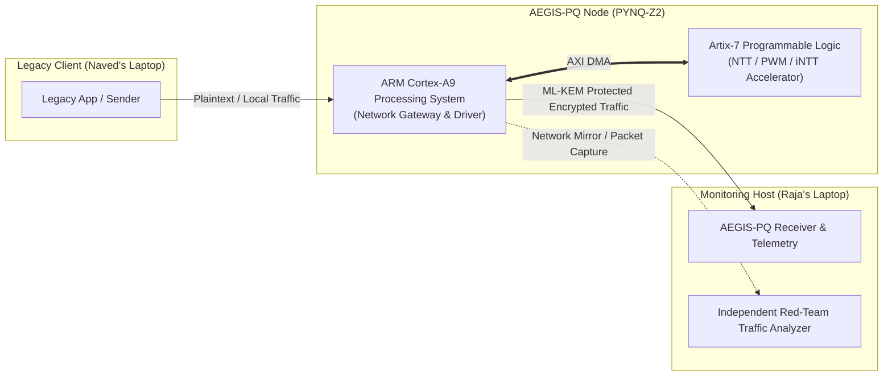
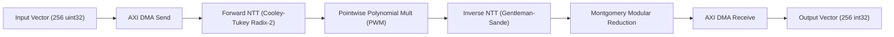

# AEGIS-PQ: Hardware-Accelerated Post-Quantum Cryptographic Offload Engine

[](LICENSE)
[-red.svg)](https://www.xilinx.com/products/silicon-devices/soc/zynq-7000.html)
[](https://csrc.nist.gov/pubs/fips/203/final)
[](#project-status)

---

## 1. Executive Overview

**AEGIS-PQ** is a compact, low-power, FPGA-accelerated post-quantum cryptographic (PQC) offload engine designed to secure legacy infrastructure against harvest-now, decrypt-later (HNDL) quantum threats without requiring wholesale replacement of host equipment or disruptive application refactoring.

Deployed as an inline bump-in-the-wire or coprocessor offload node, AEGIS-PQ transparently intercepts legacy application traffic, executes lattice-based cryptographic arithmetic on a dedicated FPGA hardware pipeline (Xilinx Zynq-7000 / Artix-7 fabric), and delivers authenticated post-quantum secure transport across unprotected networks.



---

## 2. Problem Statement & Motivation

Classical public-key cryptosystems (RSA, ECDH, ECDSA) rely on the hardness of integer factorization and discrete logarithms—problems solvable in polynomial time by quantum computers running Shor’s algorithm. 

Critical infrastructure across healthcare (PACS medical imaging), industrial SCADA systems, financial transactions, and aerospace avionics operates on 10- to 25-year hardware lifecycle cycles. These legacy endpoints cannot withstand quantum cryptanalysis, yet:
- Their embedded CPUs lack the memory and compute capacity to run lattice-based polynomial arithmetic in real time.
- Direct host firmware replacement is prohibited by certifications (FDA, IEC 62443).
- Replacing complete industrial networks carries prohibitive capital expenditure.

AEGIS-PQ solves this migration barrier by providing **inline cryptographic offloading**, executing the computationally demanding Number Theoretic Transform (NTT) pipeline on dedicated FPGA fabric while preserving standard network interfaces.

---

## 3. Hardware Architecture & Cryptographic Accelerator

### 3.1 FPGA Pipeline Architecture
The AEGIS-PQ prototype is deployed on the **Tul PYNQ-Z2** development board (Xilinx Zynq-7020 XC7Z020-1CLG400C SoC):

| Subsystem | Specification |
|---|---|
| **Processing System (PS)** | Dual-core ARM Cortex-A9 @ 650 MHz, 512 MB DDR3 |
| **Programmable Logic (PL)** | Artix-7 fabric (85K logic cells, 280 BRAM slices, 220 DSPs) |
| **Host Interface** | AXI-Lite (Control Register @ `0x00`), AXI-Stream via AXI DMA (`axi_dma_0`) |
| **Accelerator IP** | `kyber_accelerator_top_0` |
| **Bitstream Artifacts** | `PQC Kyber/bitstream/design_1.bit` (3.9 MB), `design_1.hwh` (307 KB) |
| **Clock Domain** | 100 MHz PL clock |

### 3.2 Polynomial Arithmetic Boundary
The custom RTL accelerator accelerates polynomial operations in the quotient ring:
$$R_q = \mathbb{Z}_q[X] / (X^n + 1)$$
where:
- Polynomial degree $n = 256$
- Prime modulus $q = 3329$
- Primitive 256th root of unity $\zeta \in \mathbb{Z}_q$
- Inverse modular constant $q^{-1} \equiv -3327 \pmod{2^{16}}$



### 3.3 Cryptographic Boundary Distinction
> [!IMPORTANT]
> **Polynomial Arithmetic Accelerator vs. Complete ML-KEM:**
> An FPGA NTT arithmetic core accelerates polynomial multiplication. It is **not** by itself a complete ML-KEM implementation.
> A cryptographically complete ML-KEM-512 (FIPS 203) workflow requires:
> 1. Pseudo-random sampling ($A \leftarrow \text{SampleNTT}(\text{SHAKE128}(\rho))$)
> 2. Centered binomial distribution sampling ($\text{CBD}_\eta$)
> 3. Symmetric hashing ($\text{SHA3-256}$, $\text{SHA3-512}$, $\text{SHAKE256}$)
> 4. Fujisaki-Okamoto transform for IND-CCA2 security
> 5. Key encapsulation ($\text{Encaps}$) and decapsulation ($\text{Decaps}$)
> 6. Valid shared secret derivation ($\text{SS} = \text{KDF}(\dots)$) followed by authenticated symmetric encryption ($\text{AES-256-GCM}$ or $\text{ChaCha20-Poly1305}$).
>
> AEGIS-PQ explicitly separates FPGA polynomial acceleration from the host-level KEM orchestration and authenticated transport layers.

---

## 4. Live PYNQ-Z2 Board Audit & Verification

Live read-only hardware verification on the active development board confirmed:
- **Board IP:** `192.168.0.2` (Jupyter on port 9090, SSH on port 22, Web on port 80)
- **OS & Kernel:** Linux `5.4.0-xilinx-v2020.2` #1 SMP PREEMPT (armv7l GNU/Linux)
- **PYNQ Runtime:** Version `2.7.0` on Python `3.8.2`
- **Memory & Storage:** 512 MB total RAM (330 MB available); Root filesystem `/` has 5.4 MB free (100% capacity utilized, strictly requiring zero-bloat software services).
- **Target Project Directory:** `/home/xilinx/jupyter_notebooks/pqc_kyber512`
- **Resident Dashboard:** Standalone Flask server (`app.py`, port 5000) interacting via `kyber_hal.py` with `design_1.bit`.

---

## 5. Three-Node Live Demonstration Architecture

The live demonstration comprises three interconnected nodes:

| Node | Physical Entity | Operating Role | Interface / Responsibility |
|---|---|---|---|
| **Node 1** | Naved's Laptop | **Legacy Client** | Generates application data (diagnostic medical scans / industrial sensor streams) and selects transmission mode without local PQC capabilities. |
| **Node 2** | PYNQ-Z2 Board | **Hardware Offload Gateway** | Intercepts transmission, executes hardware-accelerated NTT arithmetic, orchestrates ML-KEM session establishment, and encrypts payloads with authenticated AEAD. |
| **Node 3A** | Raja's Laptop | **Telemetry Dashboard & Receiver** | Reconstructs payload, verifies MAC authentication tags, logs latency, speedup distributions, and system telemetry. |
| **Node 3B** | Raja's Laptop | **Red-Team Security Analyzer** | Independent packet inspector capturing real network traffic, verifying tamper rejection, and testing cryptographic resistance. |

---

## 6. Repository Structure

```text
AEGIS-pq/
├── .gitignore                      # Ignore patterns for secrets, bloated binaries, caches
├── README.md                       # Comprehensive system architecture & reproduction guide
├── docs/
│   ├── development/
│   │   └── continuous_integration_log.md   # Chronological development & push audit log
│   └── reconnaissance/             # Authoritative technical audit reports
│       ├── 00_master_reconnaissance_report.md
│       ├── 01_workspace_inventory.md
│       ├── 02_project_evolution.md
│       ├── 03_fpga_hardware_audit.md
│       ├── 04_existing_dashboard_audit.md
│       ├── 05_three_node_architecture_audit.md
│       ├── 06_cryptographic_design_review.md
│       ├── 07_system_boundaries_and_dependencies.md
│       ├── 08_network_and_deployment_review.md
│       ├── 09_capability_gap_matrix.md
│       ├── 10_validation_strategy.md
│       ├── 11_implementation_roadmap.md
│       └── 12_live_pynq_verification_log.md
├── PQC Kyber/
│   ├── bitstream/
│   │   ├── design_1.bit            # Hardware accelerator FPGA bitstream
│   │   └── design_1.hwh            # Hardware handoff metadata and AXI register map
│   ├── src/
│   │   ├── kyber_accelerator.cpp   # Vivado HLS source implementation
│   │   ├── Jupyter Notebook Codes for PQC Kyber.py
│   │   └── Final PL Output         # Hardware verification output
│   └── docs/                       # Project documentation & presentation reports
└── tests/                          # Automated verification suite (cryptography, protocols, mocks)
```

---

## 7. Setup & Reproduction Guide

### 7.1 Prerequisites
- Python 3.8+ (Host machine & PYNQ-Z2)
- NumPy, Cryptography, Paramiko, Requests, Flask
- Physical or emulated PYNQ-Z2 board with Xilinx Vivado / PYNQ 2.7.0 environment

### 7.2 Running Local Verification
```bash
# Clone the repository
git clone https://github.com/Raja-sys77/AEGIS-pq.git
cd AEGIS-pq

# Install dependencies
pip install -r requirements.txt

# Run offline cryptographic and interface tests
python -m unittest discover tests/
```

### 7.3 Board Connection (Read-Only Inspection)
```bash
# Verify connectivity
ssh xilinx@192.168.0.2

# Target directory
cd /home/xilinx/jupyter_notebooks/pqc_kyber512

# Inspect running dashboard without disruption
ps aux | grep app.py
```

---

## 8. Development & Integrity Principles

1. **Evidence-Based Metrics:** Hardware speedups (e.g., reported ~27× acceleration) are derived exclusively from verified, repeated hardware timing loops versus native software execution, never hardcoded.
2. **Cryptographic Rigor:** No simulated cryptographic shortcuts (such as hashing raw NTT output) are substituted for NIST FIPS 203 ML-KEM key encapsulation.
3. **Hardware Preservation:** Existing bitstreams, PYNQ dashboards, and onboard configurations are strictly preserved.

---

## 9. License

This project is licensed under the Apache License 2.0. See [LICENSE](LICENSE) for details.
