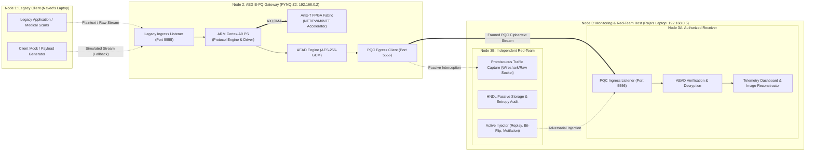
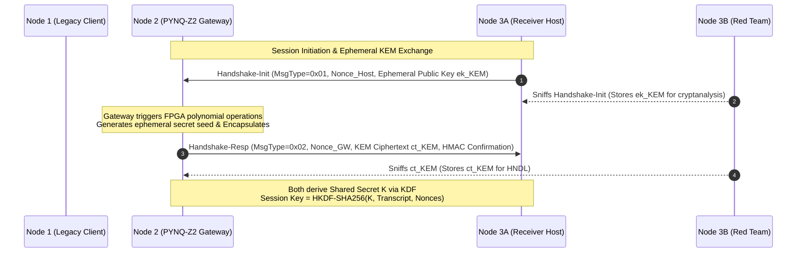
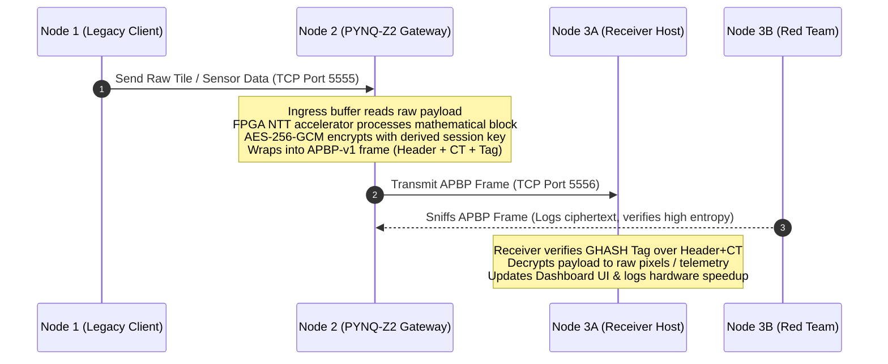
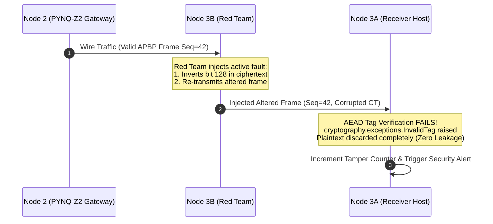

# 05. Three-Node Demonstration Architecture Audit

## 1. Executive Summary & System Objectives

The **AEGIS-PQ** demonstration is designed to showcase an inline, bump-in-the-wire post-quantum cryptographic (PQC) offload architecture. The system secures legacy industrial and enterprise endpoints against harvest-now, decrypt-later (HNDL) quantum threats without requiring hardware obsolescence, firmware refactoring, or re-certification of legacy edge clients.

To prove feasibility under realistic operating constraints, the demonstration partitions functionality across three distinct operational nodes:
1. **Node 1 (Legacy Client — Naved's Laptop):** An un-upgraded endpoint transmitting standard, unencrypted or legacy-encrypted application traffic (e.g., DICOM medical scans or SCADA industrial telemetry).
2. **Node 2 (Cryptographic Processing Node / Gateway — PYNQ-Z2):** An edge inline gateway hosting the Xilinx Zynq-7020 SoC, intercepting legacy traffic, executing hardware-accelerated lattice polynomial arithmetic in Artix-7 programmable logic (PL), deriving cryptographically valid session keys, and transmitting authenticated post-quantum ciphertext frames.
3. **Node 3 (Dual-Role Host Laptop — Raja's Laptop):** A modern computing host executing two logically decoupled roles:
   - **Node 3A (Telemetry Dashboard & Receiver):** Authorized receiver decrypting incoming post-quantum ciphertext, verifying cryptographic authentication tags, and presenting real-time telemetry, latency figures, and hardware acceleration metrics.
   - **Node 3B (Independent Red-Team Security Analyzer):** Independent network inspection station passively capturing wire traffic, evaluating cryptanalytic resistance, and executing active fault injection (ciphertext bit flips, replay attacks, tag truncation) to demonstrate authenticated drop behavior.



---

## 2. Node Breakdown & Operating Contracts

### 2.1 Node 1: Legacy Client (Naved's Laptop)
- **Physical Identity:** Dell / Lenovo Laptop operated by Naved.
- **Operating Role:** Legacy workstation transmitting high-value diagnostic imagery (e.g., 512×512 grayscale or RGB DICOM medical scans) or time-series SCADA sensor telemetry.
- **Cryptographic Capability:** Strictly classical or null. Represents an FDA-cleared medical device or legacy PLC with no hardware or software capability to execute lattice-based cryptography.
- **Network Interface:** Standard TCP socket client targeting Node 2 ingress.
  - Target IP: `192.168.0.2`
  - Target Port: `5555`
  - Protocol: Unframed raw binary stream or simple JSON payload over TCP.
- **Temporary Unavailability & Mock Protocol Contract:**
  - *Operational Reality:* Naved's laptop may not be physically present or connected during bench testing or initial integration phases.
  - *Engineering Requirement:* System development and validation must not block on Node 1 availability.
  - *Mock Architecture:* A Python-based **Legacy Client Mock (`mock_legacy_client.py`)** is specified to execute either locally on Host (Node 3 via loopback/alternate IP) or directly on the network, emitting byte-identical payloads.
  - *Payload Options:*
    1. `IMAGE_TILES`: 512×512 PNG/JPEG sliced into 64 discrete 64×64 pixel tiles (matching the established AakashNet test patterns in `app.py`).
    2. `SCADA_TELEMETRY`: 256-sample floating-point or integer sensor arrays formatted as raw binary or JSON arrays.
    3. `CONTINUOUS_STREAM`: Configurable frame-rate streaming (1 Hz to 30 Hz) simulating live edge telemetry.

### 2.2 Node 2: Cryptographic Processing Node / Gateway (PYNQ-Z2)
- **Physical Identity:** Tul PYNQ-Z2 development board hosting the Xilinx Zynq-7020 SoC.
- **Network Configuration:**
  - Interface: `eth0` (Static or DHCP on subnet `192.168.0.0/24`)
  - IP Address: `192.168.0.2` (Verified active via live ICMP ping and SSH audit)
  - Management Ports: Port 22 (OpenSSH 8.2p1), Port 9090 (Jupyter Notebook)
  - Resident Dashboard: Port 5000 (Flask server running `app.py`)
  - Gateway Ingress Listener: Port 5555 (TCP socket receiving Node 1 legacy data)
  - Gateway Egress Client: Outbound TCP connection to Node 3 on Port 5556
- **Processing System (PS) Responsibilities:**
  - Ingress buffer management and payload boundary validation.
  - Orchestration of ML-KEM session negotiation with Node 3A.
  - DMA buffer allocation (`pynq.allocate`) and cache invalidation.
  - Control register dispatch (`kyber_accelerator_top_0` @ `0x00` $\leftarrow$ `0x01`).
  - Session key derivation via HKDF-SHA256 from verified KEM shared secrets.
  - Symmetric payload encryption and authentication via AES-256-GCM.
  - Framing into AEGIS-PQ protocol frames and outbound dispatch.
- **Programmable Logic (PL) Responsibilities:**
  - Dedicated hardware execution of NTT, Pointwise Polynomial Multiplication (PWM), and iNTT pipelines via `kyber_accelerator_top_0`.
  - Clock frequency: 50.0 MHz.
  - AXI DMA channel transfer: 1024 bytes (256 × 32-bit words) per polynomial transform.
- **Coexistence Constraints:**
  - Memory footprint: Must run within available RAM (330 MB free) without memory leaks.
  - Storage footprint: Zero writes to root filesystem `/` (which has only 5.4 MB free capacity).
  - Port isolation: Must not collide with Port 5000 or disrupt `kyber_hal.py` overlay state.

### 2.3 Node 3A: Telemetry Dashboard & Receiver (Raja's Laptop)
- **Physical Identity:** Windows 11 Host Laptop (`192.168.0.5`).
- **Operating Role:** Primary authorized receiver of post-quantum protected edge telemetry.
- **Network Configuration:**
  - Ingress Listener: Port 5556 (TCP socket listening for Node 2 connections).
- **Processing Responsibilities:**
  - Session establishment: Stores ML-KEM private key, executes decapsulation or assists encapsulation, and derives identical session keys via HKDF-SHA256.
  - Frame disassembly: Strips 36-byte AEGIS-PQ header, validates sequence numbers and timestamps.
  - Cryptographic verification: Passes ciphertext, IV, and 16-byte authentication tag to AES-256-GCM engine; aborts immediately on tag failure.
  - Telemetry recording: Tracks hardware acceleration metrics, transfer latency ($\Delta t_{\text{ingress}} \to \Delta t_{\text{egress}}$), throughput (kB/s), and decapsulation cycle counts.
  - Payload reconstruction: Reassembles 64 tiles into 512×512 image, displaying side-by-side comparisons of original, encrypted, and restored images.

### 2.4 Node 3B: Independent Red-Team Security Analyzer
- **Physical Identity:** Co-located process on Host Laptop (or independent network interface) operating in adversarial mode.
- **Operating Role:** Independent verifier of system cryptographic claims.
- **Investigation & Attack Capabilities:**
  1. *Passive Wiretapping (HNDL Threat Verification):*
     - Captures raw wire frames on Port 5556 via Scapy / Wireshark.
     - Performs Shannon entropy testing: verifies ciphertext entropy $H \approx 7.999\text{ bits/byte}$, confirming zero plaintext leakage or repeating keystream artifacts.
     - Logs captured ciphertexts to disk, demonstrating the harvest-now threat model.
  2. *Active Fault & Tamper Injection (IND-CCA2 / AEAD Verification):*
     - **Attack Scenario A (Single-Bit Ciphertext Flip):** Inverts 1 bit in the ciphertext payload. Verifies Node 3A's AEAD engine detects authentication tag mismatch and drops the frame with zero bytes decoded.
     - **Attack Scenario B (Replay Attack):** Captures Frame $N$ and retransmits it after Frame $N+2$. Verifies sequence-number window detection rejects the replayed packet.
     - **Attack Scenario C (Tag Truncation / Forgery):** Mutilates or zeroes the 16-byte authentication tag. Verifies immediate rejection.
     - **Attack Scenario D (Classical RSA Key Compromise):** Simulates recovery of a legacy RSA-512 private key, demonstrating total retroactive plaintext recovery on legacy channels, in contrast to forward-secret ML-KEM channels.

---

## 3. Protocol Architecture & Framed Messaging Specification

To prevent stream confusion, buffer overruns, and side-channel leakage, all communication between Node 2 and Node 3 adheres to a strictly defined, length-prefixed binary framing format: the **AEGIS-PQ Binary Protocol (APBP-v1)**.

### 3.1 Frame Structure (APBP-v1)

Each APBP frame consists of a fixed-length **36-byte Header**, followed by a **Variable-Length Payload**, terminated by a **16-byte AEAD Authentication Tag**:

```text
 0                   1                   2                   3
 0 1 2 3 4 5 6 7 8 9 0 1 2 3 4 5 6 7 8 9 0 1 2 3 4 5 6 7 8 9 0 1
+-+-+-+-+-+-+-+-+-+-+-+-+-+-+-+-+-+-+-+-+-+-+-+-+-+-+-+-+-+-+-+-+
|          Magic (0xAE51)       |    Version    |   Msg Type    |
+-+-+-+-+-+-+-+-+-+-+-+-+-+-+-+-+-+-+-+-+-+-+-+-+-+-+-+-+-+-+-+-+
|                     Sequence Number (64-bit)                  |
|                                                               |
+-+-+-+-+-+-+-+-+-+-+-+-+-+-+-+-+-+-+-+-+-+-+-+-+-+-+-+-+-+-+-+-+
|                      Timestamp ms (64-bit)                    |
|                                                               |
+-+-+-+-+-+-+-+-+-+-+-+-+-+-+-+-+-+-+-+-+-+-+-+-+-+-+-+-+-+-+-+-+
|                       Nonce / IV (96-bit)                     |
|                                                               |
|                                                               |
+-+-+-+-+-+-+-+-+-+-+-+-+-+-+-+-+-+-+-+-+-+-+-+-+-+-+-+-+-+-+-+-+
|                     Payload Length (32-bit)                   |
+-+-+-+-+-+-+-+-+-+-+-+-+-+-+-+-+-+-+-+-+-+-+-+-+-+-+-+-+-+-+-+-+
|                                                               |
|                   Ciphertext Payload (Variable)               |
|                     Length = Payload Length                   |
|                                                               |
+-+-+-+-+-+-+-+-+-+-+-+-+-+-+-+-+-+-+-+-+-+-+-+-+-+-+-+-+-+-+-+-+
|                                                               |
|                    AEAD Tag (128-bit / 16B)                   |
|                                                               |
|                                                               |
+-+-+-+-+-+-+-+-+-+-+-+-+-+-+-+-+-+-+-+-+-+-+-+-+-+-+-+-+-+-+-+-+
```

### 3.2 Header Field Definitions

| Field | Offset | Length | Type | Description |
|---|---|---|---|---|
| **Magic** | 0x00 | 2 Bytes | Big-Endian uint16 | Constant synchronization marker: `0xAE51` ("AEGIS-PQ"). |
| **Version** | 0x02 | 1 Byte | uint8 | Protocol revision: `0x01` for APBP-v1. |
| **Msg Type** | 0x03 | 1 Byte | uint8 | Message classification:<br/>`0x01`: Handshake Init (KEM Encapsulation Request)<br/>`0x02`: Handshake Response (Ciphertext & Confirmation)<br/>`0x03`: Post-Quantum Encrypted Data (PQC + AES-GCM)<br/>`0x04`: Legacy Baseline Data (RSA Encrypted / Plaintext)<br/>`0x05`: Heartbeat / Keepalive<br/>`0xEE`: Security Alert / Tamper Detected |
| **Sequence Number** | 0x04 | 8 Bytes | Big-Endian uint64 | Strictly monotonic counter starting at 0 per session. Replay protection. |
| **Timestamp** | 0x0C | 8 Bytes | Big-Endian uint64 | UTC timestamp in milliseconds since Unix epoch. Used for latency audit. |
| **Nonce / IV** | 0x14 | 12 Bytes | Binary (96-bit) | Unique, non-repeating initialization vector for AES-GCM. Structured as 4-byte Gateway ID + 8-byte Sequence Number. |
| **Payload Length** | 0x20 | 4 Bytes | Big-Endian uint32 | Exact byte count $L$ of the ciphertext payload. Maximum allowed: 65,536 bytes. |
| **Ciphertext Payload**| 0x24 | $L$ Bytes | Binary | Authenticated encrypted payload bytes. |
| **Auth Tag** | 0x24 + $L$ | 16 Bytes | Binary (128-bit) | AES-GCM GHASH tag computed over Associated Data (Header bytes 0x00..0x23) and Ciphertext. |

### 3.3 Payload Limits & Buffer Management
- **Maximum Transmission Unit (MTU):** Standard Ethernet MTU is 1500 bytes.
- **Maximum Application Frame Size:** 65,536 bytes (64 KB). Large images (e.g. 512×512×3 RGB = 786 KB) are naturally fragmented into 64 discrete 12,288-byte frames (one per 64×64 tile), eliminating the need for complex TCP multi-segment reassembly buffers on the constrained PYNQ-Z2 board.
- **Minimum Valid Frame Size:** 52 bytes (36-byte header + 0-byte payload + 16-byte tag for keepalive frames).
- **Socket Buffer Allocation:** Ingress and egress TCP receive buffers are pinned to 128 KB, preventing socket buffer exhaustion while guaranteeing adequate absorption of burst telemetry.

---

## 4. End-to-End Operational Workflows

### 4.1 Phase 1: Post-Quantum Session Key Establishment
Before payload transmission begins, Node 2 and Node 3 establish an authenticated ephemeral session key:



### 4.2 Phase 2: Steady-State Inline Data Offload
Once the session is established, legacy data is intercepted and forwarded securely:



### 4.3 Phase 3: Adversarial Fault Injection & Red-Team Audit
To demonstrate genuine security against active network interference:



---

## 5. Resilience, Error Handling, and Zombie Mitigation

During development and live demonstration, embedded hardware nodes are vulnerable to communication timeouts and hardware deadlocks. The AEGIS-PQ three-node architecture incorporates four defensive mechanisms:

1. **Watchdog-Monitored AXI DMA Transfers:**
   - *Failure Mode:* In native PYNQ code, `dma.sendchannel.wait()` and `dma.recvchannel.wait()` block indefinitely in un-interruptible kernel space if the FPGA IP fails to assert `ap_done` or `TLAST`. This creates an unrecoverable "zombie state" requiring physical board power cycles.
   - *Mitigation:* As implemented in `kyber_hal.py`, every DMA transfer is monitored by a secondary watcher thread with an enforced **3.0-second timeout**. If the timer expires, the thread raises `HardwareTimeout`, logs DMA register states (`MM2S_DMASR` and `S2MM_DMASR`), resets the DMA engine via soft register write (`0x00` $\leftarrow$ `0x04`), and frees the buffer.
2. **Socket Keepalives & Reconnection Protocol:**
   - Gateway ingress (Port 5555) and egress (Port 5556) sockets utilize TCP keepalives (`SO_KEEPALIVE`, `TCP_KEEPIDLE=5`, `TCP_KEEPINTVL=2`, `TCP_KEEPCNT=3`).
   - If Node 1 or Node 3 disconnects, Node 2 gracefully drops the connection, flushes ephemeral buffers, and returns to `LISTEN` state without terminating the gateway process.
3. **Sequence Window & Anti-Replay Cache:**
   - Node 3A maintains a sliding window of observed sequence numbers (window size $W = 64$).
   - Any packet with $\text{Seq} \le \text{Seq}_{\text{max}} - W$ or an already-observed sequence number inside the window is dropped immediately without invoking decryption.
4. **Zero-Disk-Bloat Exception Logging:**
   - Because the PYNQ-Z2 board root filesystem has only 5.4 MB available storage, gateway services must not write un-rotated debug logs to disk.
   - All diagnostic logs are held in a circular in-memory ring buffer (maximum 1,000 entries) or streamed via UDP to Node 3A telemetry.

---

## 6. Verification and Acceptance Criteria

| Subsystem | Requirement | Verification Command / Method | Success Criteria |
|---|---|---|---|
| **Node 1 Contract** | Legacy client or mock delivers valid 64×64 pixel tiles or sensor vectors | Run `mock_legacy_client.py --mode tiles --target 192.168.0.2:5555` | 64 consecutive tiles sent with zero socket dropouts |
| **Node 2 Gateway** | Ingress on 5555, FPGA NTT execution, egress on 5556 | Inspect PYNQ listening sockets (`ss -tulpn`) and netstat | Port 5555 listening; outbound connection established to 5556 |
| **Node 3A Receiver** | Framed decryption, AEAD tag verification, UI reconstruction | Run receiver listener on Port 5556; compare decrypted tiles with golden input | Pixel-exact image reconstruction (0 MSE); 100% tags pass |
| **Node 3B Red Team** | Detects active bit flips; proves zero plaintext disclosure on failure | Execute `red_team_injector.py --flip-bit 128`; monitor receiver log | Receiver log records `InvalidTagException`; 0 plaintext bytes emitted |
| **Dashboard Coexistence**| Gateway operates without disrupting Port 5000 Flask dashboard | Curl `http://192.168.0.2:5000/api/status` while gateway is streaming | Port 5000 responds `200 OK` with `{"ready": true}` throughout |
