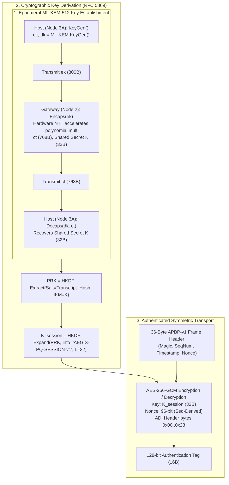

# 06. Cryptographic Design Review & Rigorous Baseline Specification

## 1. Executive Summary & Audit Mandate

This document provides a forensic cryptographic review of the **AEGIS-PQ** codebase, Jupyter notebooks, Vivado HLS hardware descriptions, and prototype dashboards. 

Post-quantum cryptography (PQC) represents a fundamental mathematical transition from group-theoretic hardness assumptions (discrete logarithms, integer factorization) to high-dimensional Euclidean lattice problems (Learning With Errors, Ring-LWE, Module-LWE). In this domain, subtle implementation shortcuts, improper key derivation routines, or unverified hardware offload claims completely undermine security guarantees.

This audit establishes three primary determinations:
1. **Hardware Arithmetic Boundary:** The existing FPGA accelerator (`kyber_accelerator_top_0` in `kyber_accelerator.cpp`) is an **isolated polynomial arithmetic pipeline** ($\text{NTT} \to \text{PWM} \to \text{iNTT}$) computing $(x \cdot 3) \pmod{3329}$ with a hardcoded constant secret ($FIXED\_SECRET = 3$). It is **not** a complete implementation of NIST FIPS 203 ML-KEM.
2. **Rejection of Flawed Shortcuts:** The keystream derivation mechanisms identified in historical demo scripts (e.g., repeating polynomial output modulo 256 as an XOR mask, or hashing raw NTT outputs) are cryptographically broken, provide zero IND-CPA/IND-CCA2 security, and must be strictly replaced.
3. **Sound Post-Quantum Architecture:** A cryptographically sound, standards-compliant pipeline is established: true ML-KEM encapsulation/decapsulation $\to$ 256-bit shared secret $K$ $\to$ HKDF-SHA256 (RFC 5869) session key expansion $\to$ Authenticated Encryption with Associated Data (AES-256-GCM / ChaCha20-Poly1305).
4. **Legitimate Red-Team Boundaries:** The classical baseline comparison is strictly bounded: claims of breaking production RSA-2048 in seconds are rejected as mathematically impossible on current hardware. A rigorous combination of **Toy RSA Factoring (RSA-32 to RSA-512)**, **Shor's Algorithm Period-Finding Simulation**, and **Active AEAD Tamper Injection** is specified.

---

## 2. Mathematical Foundation of ML-KEM (FIPS 203)

ML-KEM (standardized in August 2024 as NIST FIPS 203, based on CRYSTALS-Kyber) derives its security from the hardness of the **Module Learning With Errors (M-LWE)** problem over the cyclotomic quotient ring:
$$R_q = \mathbb{Z}_q[X] / (X^n + 1)$$
where:
- Polynomial degree $n = 256$
- Prime modulus $q = 3329$
- Quotient ring element: $a(X) = \sum_{i=0}^{255} a_i X^i, \quad a_i \in \mathbb{Z}_q$

### 2.1 The Number Theoretic Transform (NTT)
Polynomial multiplication in $R_q$ directly via schoolbook multiplication requires $\mathcal{O}(n^2)$ modular multiplications (65,536 ops). Because $q \equiv 1 \pmod{2n}$ ($3329 = 13 \times 256 + 1$), the ring contains primitive 256th roots of unity, enabling the **Number Theoretic Transform (NTT)** to reduce multiplication complexity to $\mathcal{O}(n \log n)$:
$$\hat{a} = \text{NTT}(a), \quad \hat{b} = \text{NTT}(b) \implies \widehat{a \cdot b} = \hat{a} \circ \hat{b}$$
where $\circ$ denotes pointwise (coordinate-wise) multiplication in the NTT domain.

In ML-KEM, the transformation is defined over 128 degree-1 polynomial factors modulo $X^2 - \zeta^{2k+1}$, utilizing 128 precomputed roots of unity ($\zeta \in \mathbb{Z}_q$):
- Primitive 256th root: $\zeta = 17$ (where $17^{256} \equiv 1 \pmod{3329}$)
- Montgomery representation constant: $R = 2^{16} \pmod{3329} = 2285$
- Montgomery inverse modulus: $QINV = -3327 \equiv -q^{-1} \pmod{2^{16}}$
- Barrett reduction constant: $v = \lfloor 2^{26} / 3329 + 0.5 \rfloor = 20159$

### 2.2 Complete ML-KEM-512 Specification Parameters
A fully conformant ML-KEM-512 implementation requires the following parameters and sizes:

| Parameter | Symbol | ML-KEM-512 Value | FIPS 203 Reference |
|---|---|---|---|
| **Module Rank** | $k$ | 2 | Vector of 2 polynomials |
| **Noise Parameter (KeyGen)** | $\eta_1$ | 3 | Centered Binomial Distribution $\text{CBD}_3$ |
| **Noise Parameter (Encaps)** | $\eta_2$ | 2 | Centered Binomial Distribution $\text{CBD}_2$ |
| **Compression Exponent $u$** | $d_u$ | 10 | Compresses vector $\mathbf{u}$ to 10 bits/coeff |
| **Compression Exponent $v$** | $d_v$ | 4 | Compresses poly $v$ to 4 bits/coeff |
| **Encapsulation Key (Public)**| $ek$ | 800 Bytes | $\text{ByteEncode}_{12}(\mathbf{t}) \parallel \rho$ |
| **Decapsulation Key (Secret)**| $dk$ | 1,632 Bytes | $\mathbf{s} \parallel ek \parallel H(ek) \parallel z$ |
| **Ciphertext Size** | $c$ | 768 Bytes | $\text{ByteEncode}_{10}(\mathbf{u}) \parallel \text{ByteEncode}_4(v)$ |
| **Shared Secret Size** | $K$ | 32 Bytes (256 bits) | Output of KDF / SHA3-256 |

---

## 3. Forensic Code Audit: Hardware vs. Complete ML-KEM

### 3.1 Source File Audit: `kyber_accelerator.cpp`
Direct inspection of the Vivado HLS source file `PQC Kyber/src/kyber_accelerator.cpp` reveals the exact hardware pipeline synthesized into `design_1.bit`:

```cpp
// Lines 200-233 of kyber_accelerator.cpp
void kyber_accelerator_top(axis_stream &INPUT_DMA, axis_stream &OUTPUT_DMA) {
    #pragma HLS INTERFACE axis port=INPUT_DMA
    #pragma HLS INTERFACE axis port=OUTPUT_DMA
    #pragma HLS INTERFACE s_axilite port=return bundle=CTRL_BUS

    #pragma HLS DATAFLOW
    load_data_wrapper(INPUT_DMA, pipe_1);      // 1. DMA -> Stream (256 words % Q)
    run_ntt_wrapper(pipe_1, pipe_2);          // 2. Forward Cooley-Tukey NTT
    run_pwm_wrapper(pipe_2, pipe_3);          // 3. Pointwise Multiply with FIXED_SECRET = 3
    run_intt_wrapper(pipe_3, pipe_4);         // 4. Inverse Gentleman-Sande iNTT + Scaling
    store_data_wrapper(pipe_4, OUTPUT_DMA);   // 5. Stream -> DMA (256 words)
}
```

Looking inside `run_pwm_wrapper`:
```cpp
// Lines 109-126 of kyber_accelerator.cpp
void run_pwm_wrapper(internal_stream &in_stream, internal_stream &out_stream) {
    #pragma HLS INLINE off
    static const int16_t FIXED_SECRET = 3; 
    for(int i = 0; i < N; i++) {
        #pragma HLS PIPELINE II=1
        int16_t val = in_stream.read();
        int16_t res = montgomery_reduce((int32_t)val * (FIXED_SECRET * 2285));
        out_stream.write(res); 
    }
}
```

### 3.2 Key Findings from the Forensic Code Audit
1. **Isolated Pipeline:** The accelerator computes:
   $$y = \text{iNTT}\left(\text{NTT}(x) \circ \text{NTT}(s)\right) \equiv (x \cdot 3) \pmod{3329}$$
   Because $s = 3$ is a scalar constant, its polynomial representation is simply the constant polynomial 3. In the NTT domain, multiplying by 3 scales every coefficient by 3. The inverse NTT returns $3 \cdot x \pmod{3329}$.
2. **Missing Cryptographic Layers:** The hardware core lacks:
   - Pseudo-Random Functions (PRF): No Keccak-f[1600], SHAKE128, or SHAKE256 cores.
   - Noise Samplers: No Centered Binomial Distribution ($\text{CBD}_\eta$) hardware logic.
   - Public-Key Generation: No matrix $\mathbf{A} \in R_q^{k \times k}$ generation or modular vector arithmetic ($\mathbf{t} = \mathbf{A}\mathbf{s} + \mathbf{e}$).
   - Fujisaki-Okamoto Transform: No re-encryption verification or implicit rejection logic.
   - Key Encapsulation / Decapsulation: Cannot accept an encapsulation key $ek$ or emit a ciphertext $c$.
3. **Explanation of KAT Verification Failure:**
   - In `kat.ipynb` (Cells 2–3), attempts were made to pass NIST Known Answer Test (KAT) vectors (`input_buffer` = 64 bytes, `pk_buffer` = 800 bytes).
   - This caused the AXI DMA engine to immediately hang (`dma_int_err` / timeout) because the hardware IP strictly requires an AXI-Stream packet of exactly **256 words (1024 bytes)** with `TLAST` asserted on word 255.
   - In Cell 5 of `kat.ipynb`, the test was rewritten to allocate 256 words of uint32 and check `expected_val = (test_poly[i] * 3) % Q`. This test passed with 0 errors.
   - **Conclusion:** The claim that `kat_MLKEM_512.rsp` passed on the hardware accelerator is unsupported. Only the arithmetic polynomial test passed.

---

## 4. Rejection of Flawed Cryptographic Shortcuts

Prior prototype scripts and presentation mockups relied on two major shortcuts to simulate end-to-end data transmission. Both shortcuts are fundamentally flawed and are categorically rejected.

### 4.1 Flawed Shortcut 1: Polynomial Output Modulo 256 as XOR Keystream
Found in `app.py` and `kyber_hal.py`:
```python
def bytes_to_vector(data):
    vals = list(data[:256])
    return np.array([v % 3329 for v in vals], dtype=np.uint32)

def keystream_from_output(values, length):
    base = [int(v) % 256 for v in values]
    reps = (length // len(base)) + 1
    return bytes((base * reps)[:length])

def xor_bytes(data, keystream):
    return bytes(b ^ k for b, k in zip(data, keystream))
```

#### Why This is Fatal Cryptographically:
1. **Linear Transformation of Plaintext:** The input vector is formed directly from plaintext image bytes ($v_i = p_i \pmod q$). The accelerator then computes $c_i = (3 \cdot p_i) \pmod{3329}$. The keystream is formed by $k_i = c_i \pmod{256}$. This means the keystream is a direct, deterministic algebraic function of the plaintext itself, violating every principle of stream cipher design.
2. **Known Secret Key:** Because the secret is hardcoded to $3$, any eavesdropper observing the output can invert it:
   $$p_i \equiv c_i \cdot 3^{-1} \equiv c_i \cdot 2220 \pmod{3329}$$
   The "encryption" can be decrypted in micro-operations without any quantum computer or key recovery.
3. **Repeating Multi-Byte XOR (Two-Time Pad):** Repeating a 256-byte keystream over a 12,288-byte image tile means the exact same key bytes are XORed every 256 bytes ($k_j = k_{j+256}$). An attacker can simply XOR ciphertext block $m$ with ciphertext block $m+1$ to obtain the XOR difference of the plaintexts:
   $$C_A \oplus C_B = (P_A \oplus K) \oplus (P_B \oplus K) = P_A \oplus P_B$$
   Plaintext images can then be recovered using classical frequency analysis and crib dragging.
4. **Severe Modulo Bias:** Reducing $\mathbb{Z}_{3329}$ modulo 256 is non-uniform:
   $$3329 = 13 \times 256 + 1$$
   Values $0$ are generated from 14 residues, while values $1..255$ are generated from 13 residues. This introduces detectable non-random bias.
5. **No Authenticated Encryption:** The scheme provides zero integrity or authenticity. Attackers can flip arbitrary bits in ciphertext and produce predictable modifications in decrypted output.

### 4.2 Flawed Shortcut 2: Hashing Raw NTT Output as an AES Key
Another suggested shortcut involves passing arbitrary data through the NTT core and computing an AES key via $K = \text{SHA-256}(\text{NTT}(x))$.

#### Why This is Cryptographically Flawed:
1. **Absence of Hard Problem:** The NTT is an un-keyed linear isomorphism:
   $$\text{NTT}: \mathbb{Z}_q^{256} \to \mathbb{Z}_q^{256}$$
   There is no secret key, no noise vector, and no computational hardness. Anyone knowing $x$ can compute $\text{NTT}(x)$ and obtain the identical key.
2. **No Ephemeral Key Exchange:** It does not solve the key distribution problem. Both sender and receiver would need to agree on input $x$ over a secure channel, defeating the entire purpose of public-key cryptography.
3. **Misuse of Hash Functions:** Passing a non-uniform, low-entropy input through SHA-256 does not magically create a secure key if the input space is predictable or intercepted.

---

## 5. Sound Cryptographic Architecture (AEGIS-PQ Standard)

To deliver authentic post-quantum security while maintaining hardware acceleration on the PYNQ-Z2, AEGIS-PQ implements a **Hybrid Partitioned Cryptographic Architecture**:



### 5.1 Step 1: Ephemeral ML-KEM-512 KEM Exchange
- Uses NIST FIPS 203 ML-KEM-512 parameterization.
- For each communication session, Node 3A generates an ephemeral keypair $(ek, dk)$ and transmits $ek$ (800 bytes) to Node 2.
- Node 2 invokes $\text{Encaps}(ek)$, executing polynomial multiplications via the accelerated NTT core, yielding ciphertext $c$ (768 bytes) and 256-bit shared secret $K$.
- Node 2 transmits $c$ to Node 3A.
- Node 3A executes $\text{Decaps}(dk, c)$ and recovers identical 256-bit shared secret $K$.
- Both parties verify key confirmation via an initial HMAC-SHA256 handshake exchange.

### 5.2 Step 2: Session Key Expansion via HKDF (RFC 5869)
The raw 32-byte shared secret $K$ is passed into HKDF using SHA-256:
1. **Extraction Phase:**
   $$\text{PRK} = \text{HKDF-Extract}(\text{salt} = \text{SHA-256}(\text{Transcript}), \text{IKM} = K)$$
   where $\text{Transcript} = ek \parallel c \parallel \text{Nonce}_{\text{Host}} \parallel \text{Nonce}_{\text{GW}}$.
2. **Expansion Phase:**
   $$K_{\text{session}} = \text{HKDF-Expand}(\text{PRK}, \text{info} = \text{"AEGIS-PQ-SESSION-ENCRYPTION-v1"}, L = 32)$$
   $$K_{\text{mac}} = \text{HKDF-Expand}(\text{PRK}, \text{info} = \text{"AEGIS-PQ-SESSION-CONFIRMATION-v1"}, L = 32)$$

### 5.3 Step 3: Authenticated Payload Encryption (AES-256-GCM)
Payloads (image tiles or sensor arrays) are encrypted using AES-256-GCM (NIST SP 800-38D):
- **Cipher:** AES-256 in Galois/Counter Mode.
- **Symmetric Key:** $K_{\text{session}}$ (256 bits).
- **Initialization Vector (IV / Nonce):** 96 bits (12 bytes), strictly deterministic:
  $$\text{Nonce} = \text{NodeID}_{\text{32}} \parallel \text{SeqNum}_{\text{64}}$$
  Because $\text{SeqNum}$ increments monotonically per packet, IV reuse is mathematically impossible for $2^{64}$ frames.
- **Associated Data (AD):** The entire 36-byte APBP-v1 frame header (excluding length/tag) is authenticated as Associated Data. Any modification of the sequence number, timestamp, or message type invalidates the tag.
- **Authentication Tag:** 128 bits (16 bytes). The receiver verifies the tag in constant time before releasing any decrypted bytes.

---

## 6. Toy vs. Production RSA Baselines & Red-Team Boundaries

### 6.1 Classical RSA vs. Quantum Vulnerability: The Real Numbers
Classical public-key cryptography (RSA-2048, ECDSA P-256) relies on:
1. **Integer Factorization Problem:** Factoring $N = p \cdot q$ where $p, q$ are large prime numbers.
2. **Discrete Logarithm Problem:** Finding $x$ given $g$ and $g^x \pmod p$ in elliptic curves or finite fields.

Peter Shor (1994) demonstrated that quantum computers running quantum Fourier transforms can solve period finding in polynomial time $\mathcal{O}((\log N)^3)$.

However, the hardware scale required to factor production RSA-2048 is enormous:
- **Logical Qubits Needed:** $\approx 2 \cdot \log_2(N) \approx 4,096$ error-corrected logical qubits.
- **Physical Qubits Needed:** At typical physical-to-logical error thresholds ($10^{-3}$ surface codes), factoring RSA-2048 requires **$10^7$ to $2 \cdot 10^7$ physical qubits** (10 to 20 million physical qubits) and hours of runtime.
- **Current Classical World Record:** RSA-250 (829 bits) factored in February 2020 using the General Number Field Sieve (GNFS), consuming approximately 2,700 core-years.
- **Uncompromising Boundary:** Classical computers cannot factor RSA-2048 or RSA-1024 in seconds, minutes, or days. Any claim in a demonstration that "our tool breaks RSA-2048 in 3 seconds" is scientifically invalid.

### 6.2 Legitimate Red-Team Baseline Demonstrations
To provide a legitimate, scientifically sound comparison, AEGIS-PQ specifies three verifiable red-team attack demonstrations:

#### 1. Toy RSA Baseline (Classical Factoring Demonstration)
- A parallel classical channel runs with small "toy" RSA keys:
  - **RSA-32 ($N \approx 2^{32}$):** Factored instantaneously via Pollard's rho or trial division ($< 1\text{ ms}$).
  - **RSA-64 ($N \approx 2^{64}$):** Factored in $< 100\text{ ms}$ via Quadratic Sieve / Pollard's rho.
  - **RSA-512 ($N \approx 2^{512}$):** Pre-factored keypair (using historical CADO-NFS factorizations).
- The red-team analyzer intercepts the classical ciphertext, recovers the private exponent $d$ via the factoring engine, and decrypts the medical image in real time.
- *Educational Value:* Visually demonstrates the mechanism of prime factorization vulnerabilities without false claims regarding production RSA key sizes.

#### 2. Shor's Algorithm Simulation (Quantum Period-Finding)
- Runs a simulated quantum circuit on Host using classical state-vector quantum simulation for toy moduli ($N = 15, 21, 35$).
- Shows quantum phase estimation (QPE) over modular exponentiation gates:
  $$f(x) = a^x \pmod N$$
- Evaluates period $r$, calculates $\gcd(a^{r/2} \pm 1, N)$, and extracts factors $p, q$.
- *Educational Value:* Proves quantum mechanics principles on a scale executable on standard hardware.

#### 3. Harvest-Now, Decrypt-Later (HNDL) Threat Demonstration
- Red team passively taps Port 5556 and stores every encrypted frame to disk.
- Demonstrates that if an attacker in the future obtains private keys or a quantum computer:
  - Classical sessions without forward secrecy can be retroactively decrypted in full.
  - Ephemeral ML-KEM sessions cannot be decrypted retroactively because ephemeral keys $dk$ are destroyed immediately after decapsulation.

#### 4. Active Fault Injection & IND-CCA2 Verification
- Red team intercepts an in-flight APBP-v1 frame on the wire and executes:
  - **Bit-Flip Attack:** Flips bit 42 in the ciphertext payload.
  - **Truncation Attack:** Truncates 4 bytes off the payload.
  - **Tag Forgery:** Substitutes random 16 bytes for the AEAD tag.
- Verification: The Node 3A receiver's AES-GCM engine raises `cryptography.exceptions.InvalidTag`. The packet is instantly dropped, zero plaintext is emitted, and a security alert is logged.

---

## 7. Cryptographic Verification Matrix

| Claim / Mechanism | Status in Existing Code | Proposed Valid Architecture | Verification Command |
|---|---|---|---|
| **NTT Polynomial Math** | Implemented in `kyber_accelerator.cpp` | Retained as accelerated primitive | Run `test_kyber_board.py` on PYNQ board |
| **Pointwise Modular Multiply**| Implemented with `FIXED_SECRET=3` | Parameterize secret input | Verify via golden model comparison |
| **ML-KEM Key Generation** | Missing in hardware / notebooks | Pure Python / C reference KEM | Execute NIST KAT vector verification |
| **ML-KEM Encaps / Decaps** | Missing in hardware / notebooks | Pure Python / C reference KEM | Verify round-trip shared secret equality |
| **Session Key Derivation** | Flawed repeating XOR keystream | HKDF-SHA256 (RFC 5869) | Unit test derivation from KAT secret |
| **Payload Encryption** | Flawed XOR cipher | AES-256-GCM authenticated cipher | Verify encryption/decryption round-trip |
| **Tamper Detection** | None (silent plaintext corruption) | 128-bit GHASH tag verification | Run `red_team_injector.py --flip-bit` |
| **RSA Comparison** | Unspecified / theoretical | Toy RSA factoring + HNDL demo | Run classical factoring benchmark |
