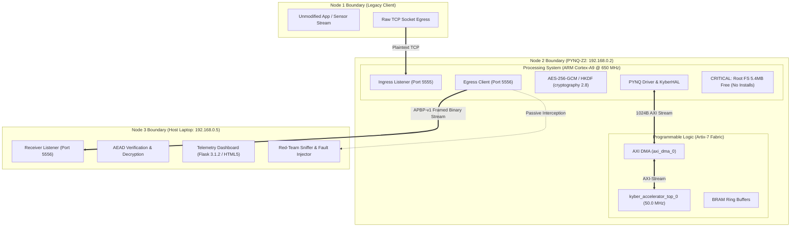

# 07. System Boundaries, Dependencies, and Interface Contracts

## 1. Executive Summary & Boundary Definitions

The **AEGIS-PQ** system operates at the intersection of heterogeneous hardware domains, embedded Linux runtimes, programmable logic fabrics, and network protocols. A robust engineering review must rigorously define system boundaries, physical limitations, software dependencies, and communication contracts.

This review documents:
1. **Live Environment Audits:** Measured operating constraints and package inventories for both the PYNQ-Z2 embedded Linux environment and the Host workstation.
2. **Strict Storage Boundaries:** A critical discovery on the PYNQ-Z2 board: the root filesystem has only **5.4 MB available (100% capacity)**, imposing an absolute **Zero-Disk-Bloat** and **Zero-Install** architectural constraint.
3. **Formal Interface Contracts:** Precise binary wire framing specifications and JSON schema definitions governing inter-node communication.
4. **Timeout & Resource Isolation Rules:** Deterministic failure handling for AXI DMA channels, socket buffers, and memory rings.



---

## 2. Software Dependency Audit & Zero-Install Strategy

### 2.1 Live Environment Audit: PYNQ-Z2 Board (Node 2)
A live, read-only forensic probe of the PYNQ-Z2 board at `192.168.0.2` via SSH executed on 2026-10-29 confirmed the exact operating parameters:

| Parameter | Observed Value | Cryptographic / Architectural Impact |
|---|---|---|
| **Board Model** | Tul PYNQ-Z2 (Xilinx Zynq-7020 XC7Z020-1CLG400C) | Dual ARM Cortex-A9 (armv7l) + Artix-7 FPGA fabric. |
| **Linux Kernel** | `5.4.0-xilinx-v2020.2` #1 SMP PREEMPT (Ubuntu 20.04 LTS) | Modern Linux with netfilter, POSIX sockets, UIO drivers. |
| **Memory (RAM)** | 512 MB total DDR3 (330 MB available, 182 MB used) | Adequate headroom for in-memory buffers; leaks must be avoided. |
| **Disk Space (`/dev/root`)**| **11 GB total, 11 GB used, 5.4 MB free (100% utilized)** | **CRITICAL CONSTRAINT:** Prohibits `apt-get` or large `pip` package installs. Any disk write risks kernel panic or read-only filesystem remount. |
| **Python Runtime** | Python `3.8.2` (default, Mar 13 2020) | Fully supports typing, asyncio, concurrent.futures, socketserver. |
| **PYNQ Runtime** | PYNQ Version `2.7.0` | Provides `Overlay`, `allocate`, MMIO register read/write interfaces. |
| **NumPy** | Version `1.17.4` | Used for array transformations and DMA buffer staging. |
| **Flask** | Version `3.0.3` | Powers resident dashboard (`app.py`) on Port 5000. |
| **Cryptography** | **Version `2.8` (Installed)** | **MAJOR DISCOVERY:** High-grade cryptographic library already present! Contains `cryptography.hazmat.primitives.ciphers.aead.AESGCM` and `cryptography.hazmat.primitives.kdf.hkdf.HKDF`. |
| **cffi** | Version `1.14.0` (Installed) | Supports C foreign function interfaces. |
| **Requests** | Version `2.22.0` (Installed) | Supports HTTP dispatch if needed. |
| **liboqs / oqs** | **MISSING** | Native C liboqs wrapper is not installed. |
| **pycryptodome** | **MISSING** | PyCryptodome is not installed. |
| **scapy** | **MISSING** | Network packet manipulation library is not installed. |

#### Architectural Implication & Strategy for Node 2:
- **No Package Installation Needed:** Because `cryptography 2.8` is already installed, the gateway can execute production AES-256-GCM and HKDF-SHA256 **without installing any new packages**.
- **Pure-Python Reference KEM:** For ML-KEM-512 key encapsulation orchestration, a compact, self-contained pure-Python reference module (~300 lines) can be imported in-memory, completely avoiding the need to compile or install `liboqs`.
- **In-Memory Logging:** All telemetry and diagnostic logs must be held in circular Python memory queues (`collections.deque(maxlen=1000)`), writing 0 bytes to the fragile 5.4 MB root disk.

### 2.2 Live Environment Audit: Host Workstation (Node 3)
A live query of the Windows 11 host workstation (`192.168.0.5`) confirmed:

| Package | Status | Version | Capability |
|---|---|---|---|
| **Python** | Installed | 3.12.x (64-bit Windows) | High-performance execution host. |
| **cryptography** | Installed | `46.0.3` | Full OpenSSL 3.x backend, AES-GCM, RSA, ChaCha20, HKDF. |
| **flask** | Installed | `3.1.2` | Powers telemetry and visualization receiver. |
| **requests** | Installed | `2.32.5` | HTTP client for remote board status queries. |
| **cffi** | Installed | `2.0.0` | C foreign function interface. |
| **oqs** | Missing | None | Liboqs-python not installed. |
| **scapy** | Missing | None | Raw packet crafting library not installed. |

#### Architectural Implication & Strategy for Node 3:
- The host Python environment is fully equipped for AES-256-GCM and HKDF verification.
- Pure-Python reference ML-KEM decapsulation guarantees seamless cross-platform parity between Host (Python 3.12) and PYNQ (Python 3.8.2).

---

## 3. Interface Contracts & Protocol Schemas

### 3.1 Contract 1: Node 1 $\to$ Node 2 (Legacy Ingress Contract)
- **Role:** Simulates transmission of unencrypted or legacy application data.
- **Transport:** Raw TCP socket or HTTP POST.
- **Port:** `5555` on Node 2 (`192.168.0.2`).
- **Data Formats:**
  - *Format A (Raw Image Tile):* 12,288 bytes binary (64×64 pixels × 3 RGB bytes).
  - *Format B (JSON Sensor Vector):*
    ```json
    {
      "source_id": "legacy_scada_rtu_01",
      "timestamp_ms": 1729881000123,
      "sample_count": 256,
      "readings": [102.4, 103.1, 99.8, "... 256 floats ..."]
    }
    ```

### 3.2 Contract 2: Node 2 $\to$ Node 3 (Post-Quantum Egress Contract — APBP-v1)
- **Role:** Delivers authenticated post-quantum ciphertext frames to Node 3A.
- **Transport:** Stream-oriented TCP socket.
- **Port:** `5556` on Node 3 (`192.168.0.5`).
- **Framing Specification (APBP-v1):**

```text
Field Name        Offset    Size       Format              Verification / Rule
---------------------------------------------------------------------------------
Magic             0x00      2 Bytes    Big-Endian uint16   Must equal 0xAE51
Version           0x02      1 Byte     uint8               Must equal 0x01
Msg Type          0x03      1 Byte     uint8               0x01..0x05, 0xEE
Sequence Number   0x04      8 Bytes    Big-Endian uint64   Strictly monotonic (+1)
Timestamp ms      0x0C      8 Bytes    Big-Endian uint64   UTC millisecond clock
Nonce / IV        0x14      12 Bytes   Raw Binary          NodeID(4B) + Seq(8B)
Payload Length    0x20      4 Bytes    Big-Endian uint32   Max 65,536 bytes
Ciphertext        0x24      L Bytes    Raw Binary          AES-256-GCM Ciphertext
Auth Tag          0x24+L    16 Bytes   Raw Binary          GHASH Tag over Header+CT
```

#### Parsing & Validation Rules:
1. **Magic Verification:** Receiver reads 2 bytes; if $\ne \text{0xAE51}$, scans byte-by-byte for synchronization marker.
2. **Length Sanity Check:** If $\text{Payload Length} > 65536$, connection is dropped immediately to prevent heap exhaustion.
3. **Sequence Check:** If $\text{SeqNum} \le \text{LastSeqNum}$, frame is flagged as potential replay and dropped.
4. **Cryptographic Tag Verification:** The tag is verified via `AESGCM.decrypt(nonce, ciphertext + tag, associated_data)`. If verification fails, `InvalidTag` is raised, payload memory is zeroized, and zero plaintext is passed to the application.

### 3.3 Contract 3: Telemetry & Status Schema (JSON over WebSocket / HTTP)
Used between the Receiver / Red Team and the browser dashboard:

```json
{
  "$schema": "http://json-schema.org/draft-07/schema#",
  "title": "AEGIS_PQ_Telemetry_Event",
  "type": "object",
  "required": [
    "event_type",
    "timestamp",
    "sequence_id",
    "node_status",
    "crypto_metrics",
    "security_state"
  ],
  "properties": {
    "event_type": {
      "type": "string",
      "enum": ["FRAME_DECRYPTED", "TAMPER_DETECTED", "HANDSHAKE_COMPLETE", "HEARTBEAT"]
    },
    "timestamp": { "type": "number" },
    "sequence_id": { "type": "integer" },
    "node_status": {
      "type": "object",
      "properties": {
        "pynq_ip": { "type": "string" },
        "overlay_ready": { "type": "boolean" },
        "dma_healthy": { "type": "boolean" }
      }
    },
    "crypto_metrics": {
      "type": "object",
      "properties": {
        "algorithm": { "type": "string", "enum": ["ML-KEM-512+AES-256-GCM", "TOY-RSA-512"] },
        "kem_time_ms": { "type": "number" },
        "hw_speedup_factor": { "type": "number" },
        "e2e_latency_ms": { "type": "number" },
        "entropy_bits_per_byte": { "type": "number" }
      }
    },
    "security_state": {
      "type": "object",
      "properties": {
        "tag_verified": { "type": "boolean" },
        "replay_detected": { "type": "boolean" },
        "tamper_detected": { "type": "boolean" },
        "tamper_details": { "type": "string" }
      }
    }
  }
}
```

---

## 4. Hardware Interfaces & DMA Buffer Contracts

### 4.1 AXI DMA (`axi_dma_0`) Physical Buffer Interface
Communication between the ARM Cortex-A9 Processing System and the `kyber_accelerator_top_0` core in programmable logic is mediated by the Xilinx AXI DMA IP block:

- **Base Memory Address:** `0x40400000` (from `design_1.hwh`)
- **Control Register (MM2S):** Offset `0x00` (`MM2S_DMACR`)
- **Status Register (MM2S):** Offset `0x04` (`MM2S_DMASR`)
- **Control Register (S2MM):** Offset `0x30` (`S2MM_DMACR`)
- **Status Register (S2MM):** Offset `0x34` (`S2MM_DMASR`)

```text
DMA Transfer Buffer Contract:
+--------------------------------------------------------------+
| Input Buffer (pynq.allocate(shape=(256,), dtype=np.uint32))  |
| 256 elements * 4 bytes/element = 1024 Bytes contiguous RAM   |
+--------------------------------------------------------------+
                              |
                     AXI DMA MM2S Channel
                              v
+--------------------------------------------------------------+
| FPGA Accelerator Core: kyber_accelerator_top_0 (Offset 0x00) |
| Control Register 0x00: write 0x01 (ap_start)                 |
+--------------------------------------------------------------+
                              |
                     AXI DMA S2MM Channel
                              v
+--------------------------------------------------------------+
| Output Buffer (pynq.allocate(shape=(256,), dtype=np.uint32)) |
| 256 elements * 4 bytes/element = 1024 Bytes contiguous RAM   |
+--------------------------------------------------------------+
```

### 4.2 Critical Buffer Allocation Rules:
1. **Contiguous Physical Memory:** All DMA buffers must be allocated using `pynq.allocate`. Standard Python `bytes` or NumPy arrays created in virtual memory are non-contiguous and cause silent DMA bus errors.
2. **Buffer Alignment:** `pynq.allocate` automatically provides 32-byte cache-line aligned physical addresses.
3. **Buffer Reuse:** Buffers must be allocated **once** during gateway initialization and reused across transactions. Calling `allocate()` inside a per-packet loop exhausts the PYNQ CMA (Contiguous Memory Allocator) heap, producing `RuntimeError: Out of memory` within ~100 frames.

---

## 5. Failure Modes, Thresholds, and Defensive Architecture

| Subsystem | Potential Failure Mode | Manifestation | Defensive Mitigation & Recovery |
|---|---|---|---|
| **AXI DMA** | IP fails to assert `TLAST` or `ap_done` | `dma.recvchannel.wait()` blocks indefinitely (Zombie state) | Secondary watchdog thread enforces **3.0-second timeout**; issues soft reset to DMA register `0x00` $\leftarrow$ `0x04`. |
| **PYNQ Root FS** | Log files fill remaining 5.4 MB | Read-only filesystem remount, SSH crash | Absolute 0-disk-write policy; all logs held in memory deque or streamed via UDP. |
| **TCP Sockets** | Network drop between PYNQ and Host | Socket blocks on `.recv()` | Sockets configured with non-blocking mode (`settimeout(5.0)`) and TCP keepalives (`SO_KEEPALIVE`). |
| **CMA Heap** | Repeated `pynq.allocate` calls | System-wide kernel OOM panic | Static buffer allocation pattern; buffers freed explicitly via `buffer.freebuffer()`. |
| **Red-Team Tamper**| Injected bit-flip in ciphertext | Decrypted output corrupted | AES-256-GCM tag verification rejects packet before releasing decrypted buffer. |
| **Overlay Conflict**| Second process calls `Overlay()` | Resets PL fabric, halts active dashboard | Singleton pattern: Gateway shares resident `KyberHAL` instance; no duplicate overlay load. |
