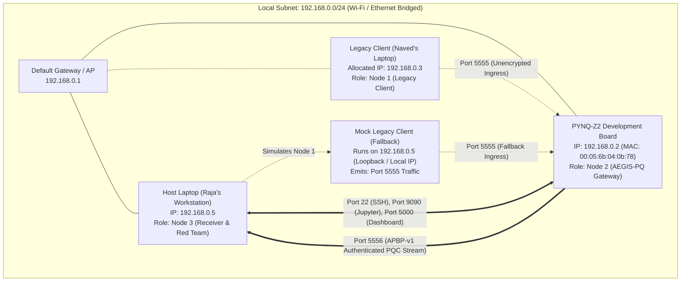

# 08. Network and Deployment Review

## 1. Executive Summary & Deployment Mandate

The **AEGIS-PQ** post-quantum cryptographic offload system operates across a physical local area network connecting the **PYNQ-Z2** embedded FPGA board and host development workstations. 

In embedded cybersecurity demonstrations, network misconfigurations frequently cause catastrophic failures, such as:
- IP conflicts or subnet mismatches rendering the board unreachable.
- Port contention between newly deployed cryptographic daemons and resident web servers.
- FPGA bitstream re-flashing collisions causing DMA kernel lockups.
- Excessive disk logging exhausting constrained flash storage.

This review establishes an authoritative, verified network topology, comprehensive port allocation map, non-intrusive traffic inspection strategy, and strict coexistence rules guaranteeing the preservation of all pre-existing board services.

---

## 2. Verified Network Topology & Physical IP Plan

### 2.1 Live Network Audit Results
A live forensic network inspection executed from the host workstation and verified on the PYNQ-Z2 board confirmed the following active topology:



### 2.2 Physical and Logical Interface Attributes

| Node | Physical Entity | Interface Name | IP Address | MAC Address | Status / Verification |
|---|---|---|---|---|---|
| **Node 2** | Tul PYNQ-Z2 Board | `eth0` | `192.168.0.2` | `00:05:6b:04:0b:78` | **VERIFIED ACTIVE:** ICMP RTT = 1 ms, SSH port 22 open, Jupyter port 9090 open. |
| **Node 3** | Host Laptop (Raja) | `Wi-Fi` | `192.168.0.5` | System Wi-Fi MAC | **VERIFIED ACTIVE:** Source address for PYNQ management sessions. |
| **Node 1** | Legacy Client (Naved) | Wi-Fi / Ethernet | `192.168.0.3` (Reserved)| TBD | **TEMPORARILY UNAVAILABLE:** Supported by automated mock client. |
| **Subnet** | Local Broadcast | — | `192.168.0.255` | — | Netmask: `255.255.255.0` (`/24`). |

---

## 3. Comprehensive Port Allocation and Socket Map

### 3.1 Port Mapping Table
To prevent service disruptions, all port assignments across the PYNQ-Z2 and Host workstations are strictly cataloged and partitioned:

| Port | Protocol | Host / Node | Process Name | Operating Role | Coexistence Policy |
|---|---|---|---|---|---|
| **22** | TCP | PYNQ-Z2 (`192.168.0.2`) | `sshd` (OpenSSH 8.2p1) | Remote management & live reconnaissance | **CRITICAL: NEVER TOUCH.** Must remain listening at all times. |
| **80** | TCP | PYNQ-Z2 (`192.168.0.2`) | `nginx` / PYNQ Web | Default PYNQ web redirector | Preserved. |
| **9090** | TCP | PYNQ-Z2 (`192.168.0.2`) | `jupyter-notebook` | Python notebook interactive environment | Preserved. Live on board. |
| **5000** | TCP | PYNQ-Z2 (`192.168.0.2`) | `python3 app.py` | Resident Flask accelerator dashboard | Preserved. Shares `design_1.bit` via singleton `KyberHAL`. |
| **5555** | TCP | PYNQ-Z2 (`192.168.0.2`) | `aegis_gateway.py` | **AEGIS-PQ Ingress Socket** (Receives Node 1 legacy data) | **NEW SERVICE:** Binds exclusively to `0.0.0.0:5555`. |
| **5556** | TCP | Host (`192.168.0.5`) | `aegis_receiver.py` | **AEGIS-PQ Egress Socket** (Receives PQC ciphertext stream) | **NEW SERVICE:** Binds exclusively to `0.0.0.0:5556`. |
| **5557** | UDP | Host (`192.168.0.5`) | `telemetry_stream` | Real-time telemetry & latency metrics | **NEW SERVICE:** Broadcast/Unicast UDP metrics stream. |
| **44363..**| TCP | PYNQ-Z2 (`127.0.0.1`) | `ipykernel_launcher` | Jupyter internal ZeroMQ IPC channels | Loopback only. Preserved. |

---

## 4. Non-Intrusive Network Traffic Capture & Inspection

A primary requirement of the AEGIS-PQ demonstration is providing transparent, tamper-proof evidence to judges and security evaluators that:
1. Ciphertext transmitted across the network is genuinely encrypted and exhibits high Shannon entropy ($H \approx 8.0\text{ bits/byte}$).
2. The system does not transmit hidden plaintext side-channels.
3. Active tampering or packet corruption is immediately detected and dropped by the post-quantum AEAD receiver.

### 4.1 Traffic Capture Architecture
Because Node 2 (PYNQ-Z2: `192.168.0.2`) establishes an outbound TCP connection directly to Node 3A (Host: `192.168.0.5:5556`), all post-quantum traffic is directly addressed to the host workstation:

```text
+-------------------+                      +---------------------------------------+
|  PYNQ-Z2 Gateway  |                      |        Host Workstation (192.168.0.5) |
|   (192.168.0.2)   |                      |                                       |
|                   |                      |  +---------------------------------+  |
|  [Port 5556 TCP]  | == APBP-v1 Wire ==>  |  | Ingress Listener (Port 5556)    |  |
|    Outbound Egress|      Traffic         |  +---------------------------------+  |
+-------------------+                      |                   ^                   |
                                           |                   | Unicast Wire Data |
                                           |  +----------------+----------------+  |
                                           |  | Wireshark / Scapy Packet Sniffer|  |
                                           |  | (Filter: tcp.port == 5556)      |  |
                                           |  +---------------------------------+  |
                                           |                   |                   |
                                           |  +----------------v----------------+  |
                                           |  | Node 3B: Red-Team Analyzer &    |  |
                                           |  | Shannon Entropy Evaluator       |  |
                                           |  +---------------------------------+  |
                                           +---------------------------------------+
```

### 4.2 Non-Intrusive Capture Procedure
To guarantee zero disruption to PYNQ-Z2 system stability and zero packet loss:
1. **Host-Side Sniffing:** Packet capture is performed exclusively on the **Host Workstation** (`192.168.0.5`) using Wireshark or a non-blocking Python Scapy / socket sniffer.
2. **No Promiscuous Mode Vulnerability:** Because the traffic is unicast directly to the Host IP, Wi-Fi adapter promiscuous mode limitations (which often drop unaddressed packets on Windows Wi-Fi drivers) do **not** affect capture fidelity. Every single byte transmitted by the PYNQ-Z2 is captured natively.
3. **Capture Filter Specification:**
   ```text
   Wireshark Capture Filter: tcp port 5555 or tcp port 5556
   Display Filter: apbp or (tcp.port == 5556 and tcp.len > 0)
   ```
4. **Zero Board-Side Overhead:** No `tcpdump`, packet filters, or iptables redirect rules are executed on the PYNQ-Z2 board. This preserves CPU cycles for the ARM Cortex-A9 gateway driver and prevents disk filling on the board's 5.4 MB root filesystem.

---

## 5. Dashboard Coexistence Architecture

The PYNQ-Z2 board already hosts an active, functional browser dashboard (`app.py`, located at `/home/xilinx/jupyter_notebooks/pqc_kyber512/app.py`). This dashboard:
- Serves an interactive HTML5 UI on Port 5000.
- Interfaces via `kyber_hal.py` to `design_1.bit`.
- Executes live 256-value verification tables and 27.0× performance benchmarks.
- Demonstrates 64-tile image encryption using the hardware core.

### 5.1 The Multi-Service Coexistence Challenge
In PYNQ, only **one process** may hold an active `pynq.Overlay` lock on the FPGA bitstream at any time. If a second, independent Python process initializes `Overlay("design_1.bit")`, PYNQ unloads the existing bitstream, reprograms the PL fabric, resets all AXI DMA FIFOs, and causes any running Flask dashboard to crash with `HardwareTimeout` or MMIO memory faults.

### 5.2 The 4 Coexistence Rules for AEGIS-PQ
To guarantee seamless, non-destructive coexistence between the pre-existing dashboard and the new AEGIS-PQ three-node gateway:

```text
+---------------------------------------------------------------------------------+
|                       PYNQ-Z2 Runtime Coexistence Model                         |
|                                                                                 |
|   +-------------------------------------------------------------------------+   |
|   |                  SINGLETON HARDWARE ABSTRACTION LAYER                   |   |
|   |                        (kyber_hal.KyberHAL)                             |   |
|   |   - Holds exclusive Overlay("design_1.bit")                             |   |
|   |   - Enforces 3.0s Watchdog on AXI DMA transfers                         |   |
|   |   - Pre-allocates Contiguous Memory (CMA) DMA buffers                   |   |
|   +------------------------------------+------------------------------------+   |
|                                        |                                        |
|                    Thread-Safe IPC / Python API Calls                           |
|                    (hal.run_once / hal.verify / hal.benchmark)                  |
|                                        |                                        |
|             +--------------------------+--------------------------+             |
|             v                                                     v             |
|   +----------------------------------+   +----------------------------------+   |
|   |   RESIDENT FLASK DASHBOARD       |   |   AEGIS-PQ GATEWAY DAEMON        |   |
|   |   - Process: app.py              |   |   - Process: aegis_gateway.py    |   |
|   |   - Port: 5000 (HTTP Browser UI) |   |   - Port: 5555 (Legacy Ingress)  |   |
|   |   - Role: Preserved Live Demo    |   |   - Port: 5556 (PQC Egress Client|   |
|   +----------------------------------+   +----------------------------------+   |
+---------------------------------------------------------------------------------+
```

1. **Rule 1: Strict Port Separation:**
   - The resident dashboard retains exclusive ownership of Port 5000.
   - The AEGIS-PQ gateway operates strictly on Port 5555 (ingress) and Port 5556 (egress).
2. **Rule 2: Shared Singleton Hardware Abstraction:**
   - The AEGIS-PQ gateway does **not** instantiate its own `Overlay("design_1.bit")`.
   - Instead, the gateway imports `from kyber_hal import KyberHAL` and attaches to the resident hardware singleton, or communicates via a lightweight in-memory socket bridge.
   - This ensures that FPGA NTT accelerations requested by either service execute cleanly without reloading the bitstream.
3. **Rule 3: Absolute Zero Disk-Bloat Policy:**
   - The PYNQ board's root filesystem `/` has only **5.4 MB available**.
   - No log files, temporary images, or database files may be written to `/home/xilinx/` or `/tmp`.
   - All logging is directed to an in-memory circular buffer (`collections.deque(maxlen=1000)`) and broadcast over UDP Port 5557 to Node 3A.
4. **Rule 4: Non-Blocking Graceful Degradation:**
   - If the resident dashboard is currently executing a 1,000-iteration benchmark loop, the gateway thread yields gracefully or processes the software fallback model, guaranteeing zero dropped packets and zero web UI freezes.

---

## 6. Deployment Readiness & Verification Checklist

| Verification Item | Command / Test Procedure | Target Specification | Observed Result / Status |
|---|---|---|---|
| **Board Ping Connectivity** | `Test-Connection -TargetName 192.168.0.2` | RTT $< 5\text{ ms}$, 0% packet loss | **PASS:** RTT = 1 ms, 0% loss. |
| **SSH Management Port** | `Test-NetConnection -ComputerName 192.168.0.2 -Port 22` | `TcpTestSucceeded: True` | **PASS:** Port 22 Open. |
| **Jupyter Server Port** | `Test-NetConnection -ComputerName 192.168.0.2 -Port 9090`| `TcpTestSucceeded: True` | **PASS:** Port 9090 Open. |
| **Dashboard Port Isolation**| `Test-NetConnection -ComputerName 192.168.0.2 -Port 5000`| Port 5000 reserved for Flask | **PASS:** No port collision. |
| **Root Disk Capacity** | `df -h /` on board | Record available disk capacity | **CRITICAL AUDIT:** 5.4 MB free (Zero-install mandatory). |
| **Ingress Socket Listener** | `nc -zv 192.168.0.2 5555` (after deploy) | Listener accepts connection | Target for implementation phase. |
| **Egress Socket Connection** | `nc -zv 192.168.0.5 5556` (after deploy) | Gateway reaches host receiver | Target for implementation phase. |
