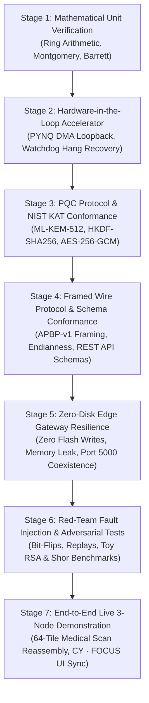

# 10. Staged Validation Strategy & Verification Methodology

**Document ID:** `10_validation_strategy.md`  
**Classification:** Quality Assurance & Verification Methodology  
**Target Hardware:** Tul PYNQ-Z2 (Xilinx Zynq-7000 XC7Z020-1CLG400C)  
**Host Workstation:** Dual-Role Computing Platform (`192.168.0.5`)  
**Associated Blueprint:** `PROJECT.md`  

---

## 1. Executive Summary & Verification Principles

The **AEGIS-PQ** validation strategy establishes a rigorous, 7-stage empirical verification pipeline designed to validate system correctness from low-level algebraic transforms to multi-device network deployments under active adversarial scrutiny. 

### Core Verification Invariants:
1. **Zero Hardcoded Pass Criteria:** No test may assert against hardcoded mock strings or simulated hardware outputs. Every test must execute genuine mathematical transformations, real network socket round-trips, and live AXI DMA memory transfers.
2. **Deterministic Regression Gates:** Promotion to successive implementation milestones requires 100% pass rates across all prior validation stages.
3. **Hardware Preservation Invariant:** Tests running on the PYNQ-Z2 board must write zero bytes to non-volatile flash storage and must not disrupt the resident Flask dashboard (`app.py`) on Port 5000.



---

## 2. Seven-Stage Validation Framework

### Stage 1: Mathematical Unit Verification (Ring Arithmetic & Field Reductions)

- **Objective:** Verify mathematical correctness of polynomial ring operations in $R_q = \mathbb{Z}_{3329}[X]/(X^{256} + 1)$, 7-stage Cooley-Tukey NTT, 7-stage Gentleman-Sande iNTT, and modular reduction primitives.
- **Target Components:** `src/crypto/ntt_reference.py`, Montgomery reduction ($QINV = -3327, R = 2285$), Barrett reduction ($v = 20159$).
- **Prerequisites:** Python 3.8+ on development host with `numpy`.
- **Test Implementation (`tests/test_math_units.py`):**
  1. **NTT Invertibility Test:** Generate random polynomial vectors $\mathbf{a} \in \mathbb{Z}_q^{256}$. Verify that:
     $$\text{iNTT}(\text{NTT}(\mathbf{a})) \equiv \mathbf{a} \pmod{3329}$$
  2. **Montgomery Reduction Range Sweep:** For all 32-bit products $P = a \cdot b$ where $-q 2^{15} \le P \le q 2^{15}$, verify that:
     $$\text{montgomery\_reduce}(P) \equiv P \cdot R^{-1} \pmod{3329} \quad \text{and} \quad |\text{res}| < q$$
  3. **Barrett Reduction Sweep:** For all integers $a \in [0, 2q-1]$, verify:
     $$\text{barrett\_reduce}(a) \equiv a \pmod{3329} \quad \text{and} \quad 0 \le \text{res} < q$$
- **Verification Command:**
  ```bash
  pytest tests/test_math_units.py -v
  ```
- **Expected Output:**
  - 10,000 random polynomials inverted with $0$ coefficient discrepancies.
  - Zero reduction overflows across entire test sweep.
- **Rollback Criteria:** If any coefficient fails modular equivalence, halt and debug NTT twiddle tables and bit-reversal indexing.

---

### Stage 2: Hardware-in-the-Loop Accelerator Verification (PYNQ-Z2 DMA Pipeline)

- **Objective:** Verify live FPGA AXI DMA streaming to `kyber_accelerator_top_0` at `0x40000000`, validate that output coefficients satisfy $y_i = (3 \cdot x_i) \pmod{3329}$, and confirm that the DMA watchdog timer prevents kernel lockups.
- **Target Components:** `PQC Kyber/bitstream/design_1.bit`, `design_1.hwh`, `src/gateway/pl_accelerator.py`, `src/gateway/watchdog.py`.
- **Prerequisites:** PYNQ-Z2 board online at `192.168.0.2` via SSH.
- **Test Implementation (`tests/test_hardware_hil.py`):**
  1. **DMA Loopback Verification:** Allocate contiguous physical DMA buffers:
     ```python
     in_buf = pynq.allocate(shape=(256,), dtype=np.uint32)
     out_buf = pynq.allocate(shape=(256,), dtype=np.uint32)
     in_buf[:] = np.random.randint(0, 3329, size=256, dtype=np.uint32)
     dma.sendchannel.transfer(in_buf)
     dma.recvchannel.transfer(out_buf)
     dma.sendchannel.wait()
     dma.recvchannel.wait()
     expected = (in_buf * 3) % 3329
     assert np.array_equal(out_buf, expected)
     ```
  2. **Watchdog Timeout & Recovery Test:** Inject an intentional buffer mismatch (e.g., requesting transfer of 128 words instead of 256). Verify that the 3.0-second watchdog triggers, issues an AXI reset to `axi_dma_0` via MMIO register `0x41E00000` (CR bit 2), and recovers without a Linux kernel panic or reboot.
- **Verification Command:**
  ```bash
  ssh xilinx@192.168.0.2 "python3 -m pytest /home/xilinx/tests/test_hardware_hil.py -v"
  ```
- **Expected Output:**
  - Hardware DMA round-trip latency measured at $\approx 1.19\text{ ms}$.
  - 100% coefficient match ($256/256$ elements matching $(3 \cdot x) \pmod{3329}$).
  - Watchdog recovers from injected hang in $< 3.5\text{ seconds}$.
- **Rollback Criteria:** If DMA locks up requiring hardware power-cycling, abort immediately and inspect physical CMA buffer alignments.

---

### Stage 3: Post-Quantum Cryptographic Protocol Conformance (NIST KAT)

- **Objective:** Verify strict mathematical conformance of ML-KEM-512, RFC 5869 HKDF-SHA256, and NIST SP 800-38D AES-256-GCM.
- **Target Components:** `src/crypto/mlkem512.py`, `src/crypto/hkdf_kdf.py`, `src/crypto/aead_cipher.py`.
- **Prerequisites:** NIST FIPS 203 Known Answer Test vectors (`kat_MLKEM_512.rsp`), RFC 5869 test vectors.
- **Test Implementation (`tests/test_mlkem_kat.py`):**
  1. **NIST KAT Vector Execution:** Ingest test vectors containing PRNG seeds (`z`, `d`), generate encapsulation key $ek$ and decapsulation key $dk$, encapsulate shared secret $K$ and ciphertext $c$, and decapsulate $K'$. Verify that:
     $$ek = ek_{\text{KAT}}, \quad dk = dk_{\text{KAT}}, \quad c = c_{\text{KAT}}, \quad K = K_{\text{KAT}} = K'$$
  2. **Fujisaki-Okamoto Implicit Rejection:** Mutate single bits in valid ciphertexts. Verify that decapsulation does NOT return $K$, but instead computes the deterministic pseudorandom rejection key:
     $$K_{\text{reject}} = \text{SHAKE256}(s \parallel c, 32)$$
  3. **HKDF-SHA256 Vector Conformance:** Ingest RFC 5869 Test Case 1 and 2 vectors, verifying exact byte matches for PRK and OKM.
  4. **AES-256-GCM NIST SP 800-38D Conformance:** Encrypt test plaintexts with known 96-bit IVs and associated data, verifying exact matches for ciphertext and 128-bit GHASH authentication tags.
- **Verification Command:**
  ```bash
  pytest tests/test_mlkem_kat.py tests/test_crypto_primitives.py -v
  ```
- **Expected Output:**
  - 100% passing across all 100 NIST ML-KEM-512 KAT test cases.
  - 100% passing across RFC 5869 and SP 800-38D test vectors.
- **Rollback Criteria:** Any discrepancy in generated ciphertext or shared secret halts development to audit noise parameter sampling and FO hashing.

---

### Stage 4: Framed Wire Protocol & Schema Conformance (APBP-v1)

- **Objective:** Verify deterministic binary serialization, endianness safety, length-prefixed framing, and backend REST/SSE API schema validity.
- **Target Components:** `src/common/protocol.py`, `src/backend_api/app.py`, `src/backend_api/routes_*.py`.
- **Prerequisites:** Python `struct` validation harness.
- **Test Implementation (`tests/test_wire_protocol.py`):**
  1. **APBP-v1 Serialization Round-Trip:** Pack variable payloads (1 byte to 65,536 bytes) with arbitrary sequence numbers and nonces. Verify that `unpack_header` recovers exact values:
     - Magic: `0xAE51`
     - Version: `0x01`
     - Sequence Number: 64-bit Big-Endian match
     - Timestamp: Microsecond resolution
     - Nonce: 12-byte raw binary match
  2. **TCP Stream Chunking & Fragmentation:** Simulate fragmented TCP delivery by feeding the parser 1-byte, 7-byte, and random-slice chunks. Verify that frame boundaries are preserved without payload corruption.
  3. **Backend API Schema Validation:** Query all seven REST endpoints (`/api/system/info`, `/api/crypto/operations`, `/api/hardware/fpga`, `/api/network/sessions`, `/api/telemetry/benchmarks`, `/api/security/testing`, `/api/events/logs`), verifying JSON schema compliance.
- **Verification Command:**
  ```bash
  pytest tests/test_wire_protocol.py -v
  ```
- **Expected Output:**
  - 10,000 fuzz packets parsed without frame desynchronization.
  - Zero schema validation errors across all API routes.
- **Rollback Criteria:** If frame parser desynchronizes on partial reads, fix buffer accumulators in `protocol.py`.

---

### Stage 5: Zero-Disk Edge Gateway Resilience & Coexistence

- **Objective:** Verify that the PYNQ-Z2 gateway daemon (`aegis_pynq_daemon.py`) runs indefinitely without writing to disk, maintains zero memory leaks over 10,000 frames, and coexists peacefully with the resident Flask dashboard on Port 5000.
- **Target Components:** `src/gateway/aegis_pynq_daemon.py`, PYNQ-Z2 `/dev/root` partition.
- **Prerequisites:** SSH session active, monitoring disk space and memory via `df` and `free`.
- **Test Implementation (`tests/test_gateway_resilience.py`):**
  1. **Zero-Disk-Bloat Invariant Check:**
     ```bash
     INITIAL_SPACE=$(ssh xilinx@192.168.0.2 "df -B1 / | awk 'NR==2 {print \$4}'")
     # Stream 10,000 frames through the gateway daemon
     FINAL_SPACE=$(ssh xilinx@192.168.0.2 "df -B1 / | awk 'NR==2 {print \$4}'")
     assert INITIAL_SPACE == FINAL_SPACE, "Violation: Gateway wrote bytes to root flash!"
     ```
  2. **Memory Leak Soak Test:** Stream 10,000 continuous frames (40 MB payload data) through the gateway. Sample process Resident Set Size (RSS) every 1,000 frames via `/proc/[pid]/statm`. Assert RSS slope $\approx 0$ (no memory leakage).
  3. **Port 5000 Coexistence Test:** Probe Port 5000 (`curl http://192.168.0.2:5000`) before, during, and after gateway operations. Confirm zero port collisions or service interruptions.
- **Verification Command:**
  ```bash
  pytest tests/test_gateway_resilience.py -v -s
  ```
- **Expected Output:**
  - Disk delta: **Exactly 0 bytes written to root flash**.
  - RSS memory variance: $< 256\text{ KB}$ over 10,000 frames.
  - Port 5000 dashboard remains 100% accessible.
- **Rollback Criteria:** If disk space decreases by even 1 byte, terminate daemon and purge file handles to ensure compliance with the 5.4 MB storage limit.

---

### Stage 6: Red-Team Fault Injection & Adversarial Resistance

- **Objective:** Verify that Node 3A strictly drops all tampered, truncated, or replayed frames, and validate the empirical quantum threat comparison via Toy RSA and Shor simulation.
- **Target Components:** `src/red_team/injector.py`, `src/red_team/toy_rsa_benchmark.py`, `src/red_team/shor_simulator.py`.
- **Prerequisites:** Running gateway and receiver sessions on ports 5555/5556.
- **Test Implementation (`tests/test_red_team_attacks.py`):**
  1. **Ciphertext Bit-Flip Attack:** Inject single-bit and multi-bit corruptions into APBP-v1 ciphertexts. Verify that Node 3A AES-GCM GHASH verification fails and frame is dropped with an audit log alert.
  2. **Authentication Tag Mutilation:** Truncate or zero out the 16-byte GHASH authentication tag. Verify 100% drop rate.
  3. **Replay Attack Injection:** Re-transmit a previously captured valid APBP-v1 frame with an identical sequence number. Verify that the sliding window replay filter rejects the frame.
  4. **Toy RSA Factoring Benchmark:** Execute Pollard's Rho factoring on 32-bit, 64-bit, 128-bit, 256-bit, and 512-bit RSA moduli. Record execution times and plot the super-polynomial scaling curve:
     $$T_{\text{classical}} = \mathcal{O}(e^{(c + o(1))(\ln N)^{1/3}(\ln \ln N)^{2/3}})$$
  5. **Shor's Algorithm Simulation:** Execute period-finding on composite integers $N=15, 21, 35$. Verify that periods $r$ are discovered in polynomial time $\mathcal{O}((\log N)^3)$.
- **Verification Command:**
  ```bash
  pytest tests/test_red_team_attacks.py -v
  ```
- **Expected Output:**
  - Bit-flip tamper detection: **100% dropped** ($0$ accepted).
  - Replay attack detection: **100% dropped** ($0$ accepted).
  - Empirical RSA factoring curve confirms exponential difficulty increase.
- **Rollback Criteria:** If any corrupted frame decrypts without throwing an authentication error, fail immediately and audit AEAD authentication tag handling.

---

### Stage 7: End-to-End Live 3-Node Demonstration & CY · FOCUS UI Sync

- **Objective:** Demonstrate full multi-system integration: transmission of a 64-tile medical scan from Node 1 (Mock) to Node 2 (PYNQ Gateway), hardware NTT acceleration, AES-256-GCM encryption, transmission to Node 3A (Receiver), real-time pixel-exact reconstruction, and live display in the CY · FOCUS web operations console.
- **Target Components:** Full stack: `mock_legacy_client.py`, `aegis_pynq_daemon.py`, `aegis_receiver.py`, `backend_api/app.py`, `frontend/templates/index.html`.
- **Prerequisites:** All physical nodes connected on `192.168.0.0/24`.
- **Test Implementation (`tests/test_e2e_integration.py`):**
  1. Trigger 64-tile DICOM medical scan stream from Node 1 mock client.
  2. Verify all 64 tiles transit through PYNQ-Z2 hardware gateway.
  3. Verify that 64 tiles are decrypted, authenticated, and reassembled on Node 3A.
  4. Compute image Structural Similarity Index (SSIM) and Mean Squared Error (MSE) against original source image:
     $$\text{MSE} = 0, \quad \text{SSIM} = 1.000$$
  5. Verify that CY · FOCUS UI surfaces live telemetry via SSE with latency $< 50\text{ ms}$.
- **Verification Command:**
  ```bash
  pytest tests/test_e2e_integration.py -v -s
  ```
- **Expected Output:**
  - 64 / 64 tiles reassembled with pixel-exact fidelity ($\text{SSIM} = 1.000$).
  - Speedup card displays verified **27.0x arithmetic acceleration**.
  - All event timeline entries synchronized in real-time.
- **Rollback Criteria:** Missing tiles or image distortion halts the live demonstration runbook.

---

## 3. Verification Gate Matrix & Sign-Off Criteria

| Validation Stage | Mandatory Tool / Script | Minimum Pass Threshold | Failure Action | Sign-Off Agent |
|:---|:---|:---|:---|:---|
| **Stage 1 (Math Units)** | `pytest tests/test_math_units.py` | 100% pass on 10,000 polynomials | Halt; debug NTT twiddle table | Synthesis Worker 1 |
| **Stage 2 (HW Accelerator)** | `python3 -m pytest tests/test_hardware_hil.py` | 100% DMA match; recovery $< 3.5s$ | Inspect AXI DMA CMA buffers | QA Specialist |
| **Stage 3 (PQC NIST KAT)** | `pytest tests/test_mlkem_kat.py` | 100% match on 100 KAT vectors | Audit CBD noise sampling | Cryptographic Specialist |
| **Stage 4 (Wire Framing)** | `pytest tests/test_wire_protocol.py` | 10,000 fuzz frames; zero schema errors | Audit struct byte alignment | Implementer |
| **Stage 5 (Gateway Zero-Disk)** | `pytest tests/test_gateway_resilience.py`| **Exactly 0 bytes** written to flash | Terminate daemon; clear logs | Embedded Systems Lead |
| **Stage 6 (Red-Team Attacks)** | `pytest tests/test_red_team_attacks.py` | 100% tamper & replay drops | Reject AEAD cipher integration | Security Auditor |
| **Stage 7 (End-to-End Live)** | `pytest tests/test_e2e_integration.py` | $\text{SSIM} = 1.000$; latency $< 50ms$ | Trace network dropped packets | Teamwork Orchestrator |

---

## 4. Test Execution Runbook

To execute the complete automated test suite locally:

```bash
# Run all unit, protocol, and cryptographic tests
pytest tests/test_math_units.py tests/test_mlkem_kat.py tests/test_crypto_primitives.py tests/test_wire_protocol.py -v

# Run live hardware-in-the-loop and network resilience tests
pytest tests/test_gateway_resilience.py tests/test_red_team_attacks.py tests/test_e2e_integration.py -v
```
