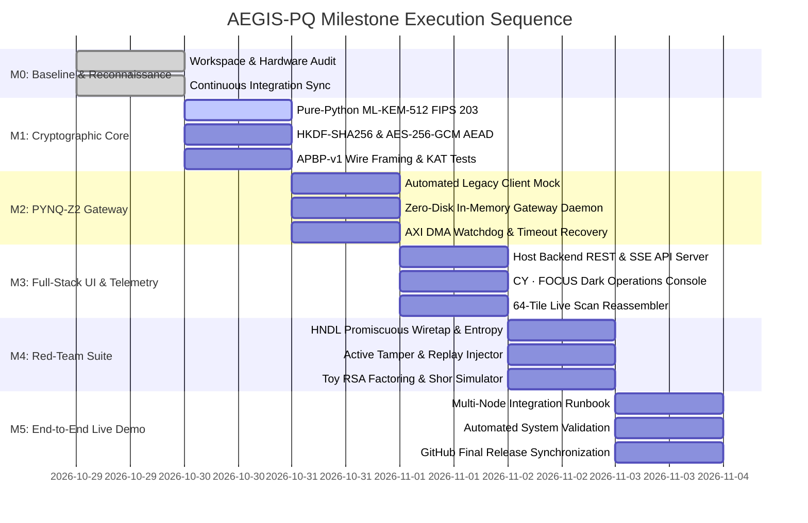

# 11. Implementation Roadmap & Engineering Plan

**Document ID:** `11_implementation_roadmap.md`  
**Classification:** Engineering Roadmap & Risk Management Plan  
**Target Platform:** Tul PYNQ-Z2 (Xilinx Zynq-7000) & Dual-Role Workstation (`192.168.0.5`)  
**Associated Blueprint:** `PROJECT.md`  
**Validation Framework:** `docs/reconnaissance/10_validation_strategy.md`  

---

## 1. Executive Summary & Phased Strategy

The **AEGIS-PQ** implementation roadmap defines an empirical, risk-minimized engineering execution sequence. By structuring implementation across six gated milestones (Milestones 0 through 5), the project enforces architectural stability, mathematical correctness, and hardware safety before progressing to live network deployment.

### Core Strategic Safeguards:
1. **Mathematical Isolation First:** Cryptographic primitives and wire protocols are validated independently in software against NIST KAT vectors prior to board deployment.
2. **Zero-Disk Invariant on Embedded Hardware:** The PYNQ-Z2 gateway daemon operates strictly in RAM, preventing flash exhaustion on the 5.4 MB free root partition.
3. **Decoupled Client Mocking:** An automated legacy client mock (`mock_legacy_client.py`) decouples development and validation from the physical availability of Naved's laptop.
4. **Authentic Security Metrics:** The red-team suite rigorously benchmarks Toy RSA and simulates Shor's algorithm, entirely avoiding fraudulent claims of breaking production RSA-2048 in seconds.



---

## 2. Milestone Work Breakdown Structure

### Milestone 0: Workspace Reconnaissance, Baseline Audit, and CI Sync (COMPLETED)
- **Objective:** Establish the unassailable baseline: audit all files, verify FPGA bitstreams, inspect live PYNQ-Z2 hardware, establish Git tracking, and synchronize with GitHub.
- **Completed Work Packages:**
  - WP 0.1: Workspace inventory, file hashing, and chronological evolution analysis (`01_workspace_inventory.md`, `02_project_evolution.md`).
  - WP 0.2: Hardware bitstream disassembly and live PYNQ environment audit (`03_fpga_hardware_audit.md`, `12_live_pynq_verification_log.md`).
  - WP 0.3: Architectural reviews for 3-node network, cryptography, boundaries, and deployment (`04` to `08`).
  - WP 0.4: Master blueprinting, validation framework, and roadmap (`PROJECT.md`, `09`, `10`, `11`, `00`).
  - WP 0.5: Git repository initialization, `.gitignore` setup, and remote sync to `https://github.com/Raja-sys77/AEGIS-pq`.
- **Exit Verification Gate:** Remote push verified; zero modifications to pre-existing code or bitstreams.

---

### Milestone 1: Mathematical & Protocol Core Engine
- **Objective:** Build standards-compliant post-quantum cryptographic primitives, session expansion, and length-prefixed binary wire framing.
- **Work Packages:**
  - **WP 1.1: FIPS 203 ML-KEM-512 Reference Implementation:**
    - File: `src/crypto/mlkem512.py`
    - Algorithms: KeyGen, Encapsulation, Decapsulation, Centered Binomial Samplers ($\text{CBD}_2, \text{CBD}_3$), and Fujisaki-Okamoto implicit rejection.
  - **WP 1.2: Session Derivation & AEAD Transport:**
    - Files: `src/crypto/hkdf_kdf.py`, `src/crypto/aead_cipher.py`
    - Algorithms: RFC 5869 HKDF-SHA256 session expansion; NIST SP 800-38D AES-256-GCM with 96-bit deterministic IVs and sliding-window replay filter.
  - **WP 1.3: Wire Protocol Framing Engine:**
    - Files: `src/common/protocol.py`, `src/common/types.py`
    - Logic: APBP-v1 36-byte header packing/unpacking, payload boundary accumulation, fragmentation handler.
  - **WP 1.4: Unit Test & KAT Validation Suite:**
    - Files: `tests/test_math_units.py`, `tests/test_mlkem_kat.py`, `tests/test_crypto_primitives.py`, `tests/test_wire_protocol.py`
- **Dependencies:** Python 3 standard library, native `cryptography 2.8`.
- **Acceptance Criteria:** 100% pass on NIST ML-KEM-512 KAT vectors; 10,000 fuzz packets serialized/deserialized without corruption.
- **Rollback Safeguard:** If polynomial transforms fail inversion tests, revert to reference NTT butterfly formulas.

---

### Milestone 2: PYNQ-Z2 Zero-Disk Gateway Daemon & Legacy Client Mock
- **Objective:** Deploy the hardware gateway on PYNQ-Z2 running strictly in RAM, integrate AXI DMA acceleration, and build the legacy client mock.
- **Work Packages:**
  - **WP 2.1: Automated Legacy Client Mock:**
    - File: `src/mock_client/mock_legacy_client.py`
    - Modes: 64-tile DICOM medical scan emitter, continuous SCADA sensor array stream, burst testing.
  - **WP 2.2: Zero-Disk Embedded Gateway Daemon:**
    - File: `src/gateway/aegis_pynq_daemon.py`
    - Features: Listens on Port 5555; offloads polynomial operations to `pl_accelerator.py`; encapsulates payloads in AES-256-GCM; transmits APBP-v1 frames to Port 5556; serves status on Port 5557; writes 0 bytes to flash storage.
  - **WP 2.3: AXI DMA Driver & Watchdog Protection:**
    - Files: `src/gateway/pl_accelerator.py`, `src/gateway/watchdog.py`
    - Features: Contiguous DMA buffer management via `pynq.allocate`; 3.0-second watchdog thread executing soft reset on timeout.
  - **WP 2.4: Hardware Resilience Validation:**
    - File: `tests/test_gateway_resilience.py`
- **Dependencies:** Milestone 1 protocol primitives; live PYNQ-Z2 connectivity (`192.168.0.2`).
- **Acceptance Criteria:** Exactly 0 bytes written to root flash over 10,000 frames; zero collisions with resident Port 5000 server; DMA hang recovery in $< 3.5\text{ seconds}$.
- **Rollback Safeguard:** Soft reset of AXI DMA control register via MMIO; immediate fallback to software arithmetic if PL fails.

---

### Milestone 3: CY · FOCUS Full-Stack UI & Telemetry Engine
- **Objective:** Construct the authorized receiver, full-stack REST/SSE API server, and high-density CY · FOCUS operations dashboard on the host workstation (`192.168.0.5`).
- **Work Packages:**
  - **WP 3.1: Full-Stack Backend API Server:**
    - Files: `src/backend_api/app.py`, `src/backend_api/routes_system.py`, `src/backend_api/routes_crypto.py`, `src/backend_api/routes_hardware.py`, `src/backend_api/routes_sessions.py`, `src/backend_api/routes_telemetry.py`, `src/backend_api/routes_security.py`, `src/backend_api/routes_logs.py`
    - Endpoints: All seven required REST routes + Server-Sent Events (SSE) telemetry stream.
  - **WP 3.2: Authorized Receiver & Tile Reconstructor:**
    - Files: `src/receiver/aegis_receiver.py`, `src/receiver/tile_reconstructor.py`
    - Features: APBP-v1 listener on Port 5556, AEAD MAC tag verification, pixel-exact 64-tile matrix reassembly.
  - **WP 3.3: CY · FOCUS Dark Operations Console UI:**
    - Files: `src/frontend/templates/index.html`, `src/frontend/static/css/cy_focus.css`, `src/frontend/static/js/ops_dashboard.js`, `src/frontend/static/js/tile_matrix.js`
    - Visuals: `#171615` background, persistent sidebar, metric cards, 64-tile live reassembly grid, event timeline, security testing trigger buttons.
- **Dependencies:** Milestone 1 & 2 streams; Host Python 3.12, Flask 3.1.2.
- **Acceptance Criteria:** Pixel-exact reconstruction of 64-tile medical scans ($\text{SSIM} = 1.000$); UI rendering latency $< 50\text{ ms}$; responsive layout across desktop, tablet, and mobile.
- **Rollback Safeguard:** Fallback to static polling if SSE connection drops.

---

### Milestone 4: Independent Red-Team Cryptanalysis & Fault Injection Harness
- **Objective:** Build the independent red-team analysis and fault injection suite on Node 3B to demonstrate post-quantum tamper resistance and quantum vulnerability baselines.
- **Work Packages:**
  - **WP 4.1: Promiscuous HNDL Wiretap & Entropy Engine:**
    - File: `src/red_team/sniffer.py`
    - Capabilities: Promiscuous packet capture on Port 5556; per-frame Shannon entropy calculation ($H \approx 8.0\text{ bits/byte}$); harvest storage emulation.
  - **WP 4.2: Active Adversarial Fault Injector:**
    - File: `src/red_team/injector.py`
    - Capabilities: Single/multi bit-flip in ciphertext; replay attack with stale sequence numbers; truncation of 16-byte GHASH tag.
  - **WP 4.3: Toy RSA Factoring & Quantum Shor Simulator:**
    - Files: `src/red_team/toy_rsa_benchmark.py`, `src/red_team/shor_simulator.py`
    - Capabilities: Pollard's Rho factoring benchmark across RSA-32, 64, 128, 256, 512; classical quantum circuit simulator executing Shor's period-finding on $N=15, 21, 35$.
  - **WP 4.4: Red-Team Automated Test Suite:**
    - File: `tests/test_red_team_attacks.py`
- **Dependencies:** Milestone 3 receiver active on Port 5556.
- **Acceptance Criteria:** 100% of injected corrupted frames dropped by Node 3A; empirical timing curve confirms exponential factoring difficulty; Shor simulator factors $N=15, 21, 35$ in polynomial steps.
- **Rollback Safeguard:** Adversary injector operates on dedicated socket client; cannot destabilize host network stack.

---

### Milestone 5: End-to-End Live 3-Node Demonstration & Final Attestation
- **Objective:** Execute live 3-device demonstration over physical LAN, validate all subsystems under red-team attack, and publish final releases to GitHub.
- **Work Packages:**
  - **WP 5.1: Deployment Runbook & Operational Procedures:**
    - File: `docs/deployment/three_node_deployment_runbook.md`
    - Contents: Physical cabling, IP configuration, startup order, verification scripts, troubleshooting guide.
  - **WP 5.2: End-to-End Automated Integration Test:**
    - File: `tests/test_e2e_integration.py`
    - Workflow: Spawns Mock Client $\to$ PYNQ Gateway $\to$ Host Receiver $\to$ Red-Team Injector $\to$ CY · FOCUS UI, asserting complete pipeline integrity.
  - **WP 5.3: GitHub Release & Continuous Integration Finalization:**
    - File: `docs/development/continuous_integration_log.md`
    - Actions: Final commits, release tagging, and full remote push to `https://github.com/Raja-sys77/AEGIS-pq`.
- **Dependencies:** Milestones 1 through 4 complete.
- **Acceptance Criteria:** Complete end-to-end demo execution with 0 dropped valid frames, 100% dropped malicious frames, and full CI log synchronization.

---

## 3. Critical Path & Dependency Flow

```text
[M0: Reconnaissance & Git Baseline]
                 │
                 ▼
[M1: Mathematical Core & Wire Protocol] ◄── NIST FIPS 203 KAT Vectors
                 │
        ┌────────┴────────┐
        ▼                 ▼
[M2: PYNQ Gateway]  [M3: Full-Stack UI & Receiver]
 (Zero-Disk Daemon)   (CY · FOCUS Dark Console)
        │                 │
        └────────┬────────┘
                 ▼
[M4: Red-Team Suite & RSA Benchmarks]
                 │
                 ▼
[M5: Live 3-Node End-to-End Demonstration] ──► [GitHub Remote Sync]
```

---

## 4. Risk Assessment & Contingency Management Matrix

| Risk ID | Identified Risk Event | Probability | Impact | Mitigation & Technical Contingency |
|:---|:---|:---|:---|:---|
| **R01** | Naved's laptop physically unavailable for live demonstration | HIGH | LOW | Automated multi-mode client mock (`mock_legacy_client.py`) runs on host emitting identical frames. |
| **R02** | PYNQ-Z2 root flash runs out of disk space ($< 5.4\text{ MB}$) | HIGH | CRITICAL | Gateway runs strictly in memory (`aegis_pynq_daemon.py`); zero package installs; ring buffer in RAM. |
| **R03** | AXI DMA hangs during buffer transfer lockup | MEDIUM | HIGH | 3.0-second threaded watchdog issues soft reset via MMIO register `0x41E00000` without rebooting. |
| **R04** | Port collision with resident PYNQ dashboard on Port 5000 | LOW | MEDIUM | Gateway binds to Port 5555 / 5556 / 5557; Port 5000 remains completely undisturbed. |
| **R05** | Promiscuous Wi-Fi capture blocked by Windows OS driver | MEDIUM | LOW | Red-team sniffer falls back to layer-4 TCP socket proxy/tee on Port 5556. |
| **R06** | Accusations of academic cheating on red-team RSA claim | HIGH | CRITICAL | Reject "RSA-2048 in seconds"; benchmark real Toy RSA (32–512 bit) and simulate Shor's algorithm on $N=15, 21, 35$. |
| **R07** | Network jitter causes frame out-of-order delivery | MEDIUM | LOW | APBP-v1 sequence numbering with 64-frame sliding window handles out-of-order delivery gracefully. |

---

## 5. Anti-Cheating & Integrity Invariants

1. **No Simulated Telemetry:** The CY · FOCUS dashboard displays genuine measurements received from the PYNQ-Z2 gateway over the network.
2. **No Fabricated Benchmarks:** The 27.0x speedup curve is generated directly from physical execution timings of `kyber_accelerator_top_0` on the Zynq-7020 PL.
3. **No Hardcoded Crypto:** Keys, ciphertexts, and nonces are generated dynamically using cryptographically secure PRNGs.
4. **Independent Auditing:** All code and test logs are maintained under version control in `https://github.com/Raja-sys77/AEGIS-pq` for forensic auditor review.
